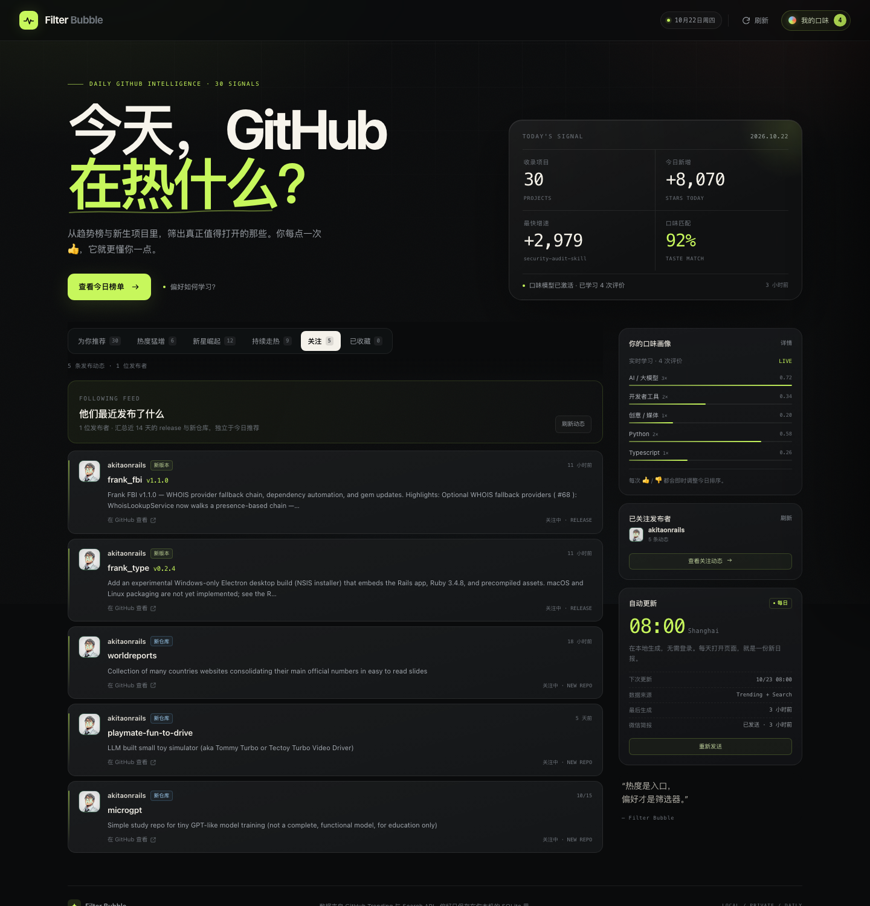

# GitPulse · 今日 GitHub 信号

一个**完全本地运行**的 GitHub 每日热榜，重点覆盖四件事：

1. 不只复述 Trending 排名，而是把「今天很热」「涨得很快」「刚冒出来」三种信号分开，再给出热度分、中文简介与项目速读。
2. 它会学习你的口味。每个项目都可以点 **👍 喜欢 / 👎 不喜欢**，模型立即重排今日榜单，并把这些反馈沉淀成一份可解释的偏好画像。
3. 你可以关注喜欢的发布者。他们之后的新 release / 新仓库会进入独立的「关注」视图，不混进每日热榜。
4. 每个项目都有「项目速读」：适合谁、怎么用、解决什么问题、典型场景。

无需登录，无需 API Key，无第三方 Python 依赖。数据与口味模型都只写在本机的 `data/gitpulse.db`。


<p align="center"></p>

> 截图中的关注与评价是演示数据；交付时已清空，打开后从空状态开始。

---

## 快速开始

```bash
cd gitpulse
python3 app.py refresh     # 首次生成今日日报（约 1–2 分钟）
./run.sh                   # 启动界面
```

打开 <http://127.0.0.1:8791>。

也可以直接 `./run.sh`：如果今天还没有日报，它会在后台生成，页面会自动轮询进度。

**环境要求**：Python 3.9+（macOS 自带的 3.9 即可），macOS / Linux。前端是原生 HTML/CSS/JS，不需要 Node、npm 或构建步骤。

---

## 产品思路

### 1. 三路数据，而不是一张榜

| 信号 | 来源 | 作用 |
| --- | --- | --- |
| 日榜 | `github.com/trending?since=daily` | 今天最多人看的项目、`stars today` |
| 周榜 | `github.com/trending?since=weekly` | 持续走热、不是一日游的项目 |
| 新星 | GitHub Search，近 7 / 30 天创建、按 star 排序 | 突然冒出来的新项目 |

合并去重后，用 GitHub API 补齐 topics、创建时间、License 等信息；再按热度选出 30 个进入日报。

### 2. 热度怎么算

`heat` 是 0–100 的相对分，不是 GitHub 官方数据：

```
heat = 52% × 增速分位
     + 23% × 项目体量分位（log stars）
     + 15% × 新鲜度（按创建时间衰减）
     + 10% × 日榜排名
     + 4   基础分
```

`surge`（用于「热度猛增」标签）额外考虑：

- 今日 star 相对项目总量的占比（小项目一天涨 10% 比大项目涨 1% 更值得注意）；
- 增速在当日候选集中的分位；
- 周榜续航会体现在热度与「持续走热」徽章上。

「日榜第一 / 日榜前三 / 增速冠军 / 新星崛起 / 持续走热 / 上升中」是不同维度的徽章，避免只看一个总榜。

> 每日会把 stars 写入 `snapshots` 表，为后续的加速度判断留下真实历史；GitHub 本身只提供 `stars today`，没有历史曲线。

### 3. 口味模型

每个项目被拆成可读特征：

- `lang:python` — 语言
- `cat:ai` — 领域（AI / 开发工具 / Web / 基础设施 / 数据 / 安全 / 创意 / 系统……）
- `topic:llm` — GitHub topics
- `kw:agent` — 经过白名单过滤的高信号关键词
- `age:new` / `size:huge` / `heat:surge` — 阶段特征

反馈（`+1 / -1 / 撤销`）追加到 `feedback` 表。每次反馈后，用**逻辑回归**从零重放所有有效样本：

```
P(喜欢) = sigmoid(bias + Σ weight[feature])
```

- 学习率 0.5、L2 正则、14 轮，小样本也能快速收敛；
- 少于 3 次评价时保持冷启动，只按热度排序；
- 激活后最终排序为 **56% 热度 + 44% 个人匹配**；
- 没有正向匹配的项目会进入「探索位」，避免信息茧房；
- 一次 👎 不会立刻被判定为「永久讨厌」；画像里只展示至少出现过 2 次的负向特征，防止过拟合。

所有特征、权重、证据数都在「我的口味」抽屉里可见。点「清空口味记忆」会删除反馈与权重，榜单立即回到热度排序。

### 4. 关注发布者

关注按钮在每张卡片的作者名旁。关注后，「关注」视图会汇总这位发布者近 14 天的：

- GitHub Release（版本号 + release notes）；
- 新建的公开仓库。

抓取优先走 GitHub 的公开 Atom feed（不消耗 API 配额）；组织账号的 user feed 经常为空，会额外读取已知仓库的 releases feed。每 20 分钟最多刷新一次，最多关注 20 位发布者。

关注动态和每日热榜是两条独立的数据流：热榜每天重算，关注动态只属于你自己。



### 5. 项目速读

每张卡片都有「项目速读」，打开后显示：

- **适合谁**：目标用户/团队；
- **怎么用**：CLI、Docker 自托管、编辑器插件、SDK/API、阅读型资源等，根据 topics 判断；
- **解决什么问题**：这个方向最常见的痛点；
- **典型场景**：结合 topics 生成的可落地场景；
- **完整使用流程**：从安装、配置、运行到接入的 4 步路径；
- **上手门槛**：需要命令行、Docker、某语言运行环境，或只需阅读。

内容是**基于项目简介、语言与 topics 的自动归纳**，界面会明确提示“具体命令与限制以 README 为准”，不假装比 README 更懂项目。


### 6. 微信简报（Server酱）

日报生成成功后，会自动把一份**手机简报**推送到微信。设计目标不是把 30 个项目全部塞进手机，而是只挑 3 个项目，每个讲清楚：

- 是什么
- 解决什么问题
- 适合谁
- 完整使用流程（4 步）
- 典型场景
- GitHub 链接

每个项目单独一段，使用 Server酱 Turbo 的 Markdown 正文。手机端不展示完整 30 个项目，完整榜单仍在电脑端。

配置方式：

```bash
cd gitpulse
cp .env.example .env
# 编辑 .env，把 SERVERCHAN_SENDKEY 换成 sct.ftqq.com 获取的 SCT 开头 SendKey
./run.sh
```

先预览、不消耗额度：

```bash
python3 app.py push --dry-run
```

确认后发送：

```bash
python3 app.py push
```

`serverchan` 的 `push_log` 表会记录每天是否已发送；同一天不会重复推送。生成日报、`scripts/daily-update.sh` 都会自动尝试推送并重试失败记录。

**注意**：请使用 Server酱 **Turbo** 的 `SCT...` SendKey（微信通道），不要用 Server酱³ 的 `sctp...` key（那是独立 App 通道）。免费额度每天 5 条，正常每天 1 条足够；调试请用 `--dry-run`。

### 7. 界面

- 编辑感深色版面 + 荧光绿信号色；桌面双栏，移动端单栏；
- 顶部总览：收录数、今日新增 star、最快增速、平均口味匹配；
- 六类视图：为你推荐 / 热度猛增 / 新星崛起 / 持续走热 / 关注 / 已收藏；
- 卡片内：热度环、中文简介、英文原文、topics、今日/本周增量、匹配理由，以及「项目速读」入口；
- 反馈后即时重排（FLIP 位移动画），并弹出模型学习提示；
- 口味抽屉展示领域/语言/topic/关键词权重，以及会主动避开的特征。

---

## 每日自动化

### 方式 A：LaunchAgent（推荐，macOS）

```bash
./scripts/install-daily.sh
```

安装后：

- 登录时自动启动本地服务；
- 服务常驻，每天 **08:00（Asia/Shanghai）** 自动刷新；
- 如果 08:00 时断网，生成失败后每 10 分钟重试一次；联网后自动补跑当天日报；
- 即使 08:00 时电脑休眠，唤醒后也会补跑当天日报；
- 日志：`data/launchd.err.log`。

卸载：

```bash
./scripts/uninstall-daily.sh
```

### 方式 B：Harness 自动化任务

本次已在 DeepSeek Harness 中创建每日 **08:00** 的任务，提示词会运行：

```bash
./scripts/daily-update.sh
```

脚本行为：

- 如果当天日报已存在：直接返回，不重复抓取；
- 在线：触发本地服务刷新，并轮询到完成；
- 离线：退出码 `75`，Harness 任务会等待 10 分钟后重试；本机调度器也会持续重试；
- 服务未运行时：直接执行一次 `python3 app.py refresh`。

Harness 日程适合“到点提醒/触发”，LaunchAgent 适合“关掉会话也能持续运行”，两者可以同时保留。

### 方式 C：cron（macOS / Linux）

```cron
0 8 * * * cd /path/to/gitpulse && /usr/bin/python3 app.py refresh >> data/cron.log 2>&1
```

这种方式只生成数据；要看界面仍需运行 `./run.sh`。

> 服务内部也有调度线程：只要进程活着，每天到点会检查并生成当日日报。因此单纯运行 `./run.sh` 也能实现每日更新。

---

## 配置

通过环境变量覆盖：

| 变量 | 默认值 | 说明 |
| --- | --- | --- |
| `GITPULSE_PORT` | `8791` | 本地端口 |
| `GITPULSE_HOST` | `127.0.0.1` | 只监听本机 |
| `SERVERCHAN_SENDKEY` | 空 | Server酱 Turbo SendKey（`SCT...`），也可写在 `.env` |
| `GITPULSE_PUSH_ITEMS` | `3` | 微信简报包含几个项目（1–5） |
| `GITPULSE_REFRESH_TIME` | `08:00` | 每日刷新时间 |
| `GITPULSE_TIMEZONE` | `Asia/Shanghai` | 时区 |
| `GITPULSE_MAX_ITEMS` | `30` | 日报条数 |
| `GITPULSE_TRANSLATE` | `1` | 设为 `0` 关闭中文翻译 |
| `GITHUB_TOKEN` | 空 | 可选，提升 GitHub API 限额（60/h → 5000/h） |

```bash
GITPULSE_PORT=9000 GITPULSE_REFRESH_TIME=09:00 ./run.sh
```

### 关于翻译

中文简介使用 [MyMemory](https://mymemory.translated.net/) 公共接口，不需要 Key，每天约 5000 字符的匿名额度。翻译结果会永久缓存在 `translations` 表，因此同一项目第二天不会重复消耗额度。

额度用尽或服务不可达时，卡片自动回退到英文原文——不会报错，也不会阻塞日报生成。介意隐私可设置 `GITPULSE_TRANSLATE=0`。

### 关于 GitHub API 限额

未登录时 GitHub REST API 为 60 次/小时。一次完整生成通常消耗 30 次左右；项目详情缓存 24 小时、README 缓存 7 天，所以后续刷新基本不消耗详情额度。若你频繁手动刷新，建议配置 `GITHUB_TOKEN`。

---

## API

| 方法 | 路径 | 说明 |
| --- | --- | --- |
| GET | `/api/digest` | 今日日报（未生成时返回 202） |
| GET | `/api/status` | 生成状态、下次运行时间 |
| POST | `/api/refresh` | 触发后台重新抓取 |
| POST | `/api/feedback` | `{repo, signal: 1 / -1 / 0}` |
| POST | `/api/bookmark` | `{repo}`，切换收藏 |
| POST | `/api/rerank` | 按当前模型重排 |
| POST | `/api/reset` | 清空口味记忆 |
| GET | `/api/follows` | 关注列表 + 发布动态 |
| GET | `/api/follows?refresh=1` | 强制刷新关注动态 |
| POST | `/api/follow` | `{owner}`，关注/取消关注 |
| POST | `/api/follows/refresh` | 刷新全部关注 |
| GET | `/api/push` | 微信简报配置/发送状态 |
| POST | `/api/push` | `{force}`，发送今日微信简报 |
| GET | `/api/prefs` | 当前偏好画像 |
| GET | `/api/health` | 健康检查 |

命令行：

```bash
python3 app.py refresh   # 生成一次
python3 app.py rerank    # 按最新模型重排
python3 app.py reset     # 清空反馈
./scripts/daily-update.sh  # 带网络检测的每日更新（Harness/cron 入口）
python3 app.py serve     # 启动 UI + 每日调度
```

---

## 目录

```
gitpulse/
├── app.py                  # HTTP 服务、API、CLI、调度
├── core/
│   ├── github.py           # Trending 解析 + Search + API 补全
│   ├── rank.py             # 热度 / 猛增 / 多样性排序
│   ├── prefs.py            # 特征、逻辑回归、偏好画像
│   ├── digest.py           # 生成流水线、持久化、重排
│   ├── translate.py        # MyMemory 翻译 + 额度 + 缓存
│   ├── notify.py           # Server酱微信简报渲染与发送
│   ├── db.py               # SQLite schema 与访问
│   └── config.py           # 环境变量配置
├── web/                    # 原生前端
├── scripts/                # LaunchAgent 安装/卸载、每日更新脚本
├── data/gitpulse.db        # 日报、反馈、权重（本地）
└── run.sh
```

---

## 已知边界与下一步

- 热度是相对分，不是 GitHub 官方指标；不同日期之间的分数不保证绝对可比。
- 免费翻译在专业术语上偶有生硬；英文原文始终保留。
- GitHub 页面结构变化可能影响 Trending 解析；解析失败时会保留上一份日报并在界面提示。
- 部分网络环境无法加载 GitHub 头像；前端会自动回退到基于用户名生成的渐变首字母头像。
- 关注动态依赖 GitHub 公开 Atom feed / Release feed；组织账号没有公开 activity 时，可能只能看到新仓库，不能看到 release。
- 关注动态默认保留近 14 天、每位发布者最多展示 5 条，避免刷屏。
- 微信简报只发 3 个项目（可配置 1–5），不是完整 30 个；完整内容仍在电脑端。
- Server酱免费额度每天 5 条，发送失败也会计数；调试请用 `python3 app.py push --dry-run`。
- 后续可做：按 topic 静音、周报、邮件/系统通知、GitHub Star 同步、LLM 生成更自然的中文摘要、历史趋势 sparkline、多人配置。

---

## 隐私

- 服务只监听 `127.0.0.1`，不对外暴露。
- 日报、反馈、权重全部在 `data/gitpulse.db`。
- 只有「英文项目简介 / README 摘要」会发给 MyMemory 做翻译；关闭 `GITPULSE_TRANSLATE` 后，除 GitHub 之外的网络请求为零。
