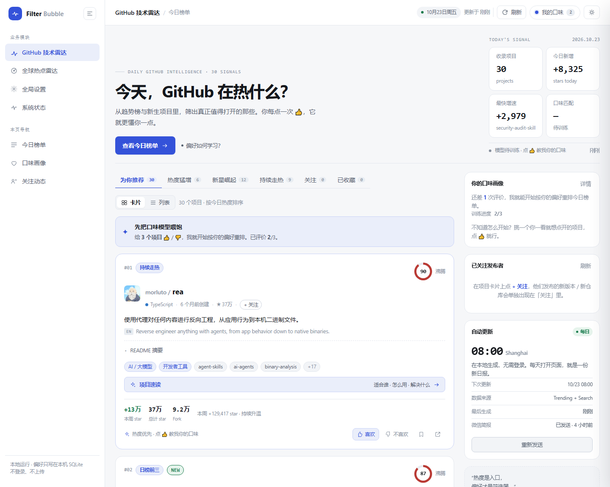
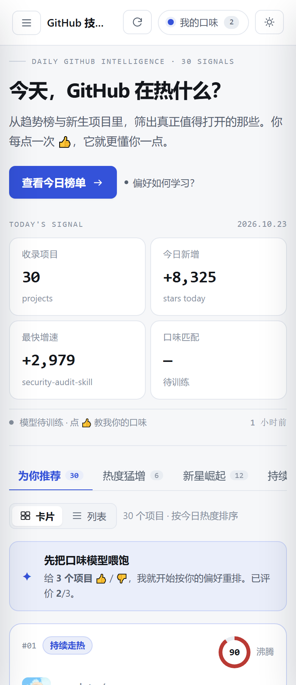
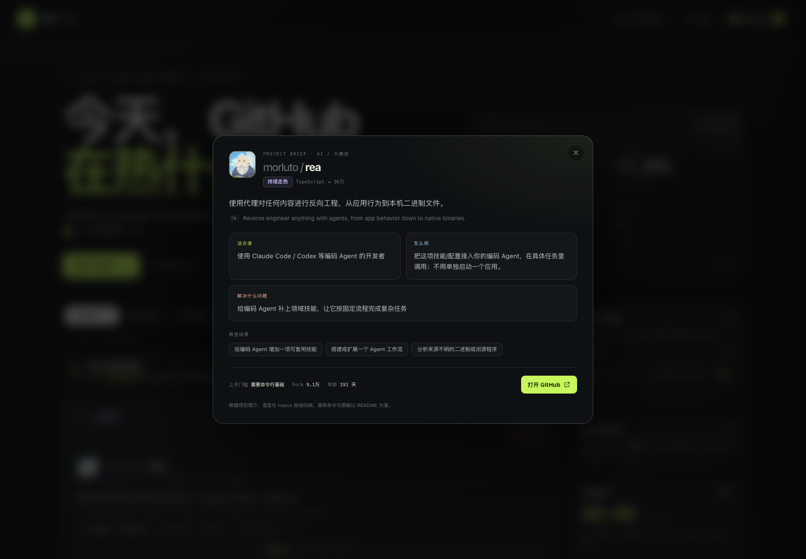
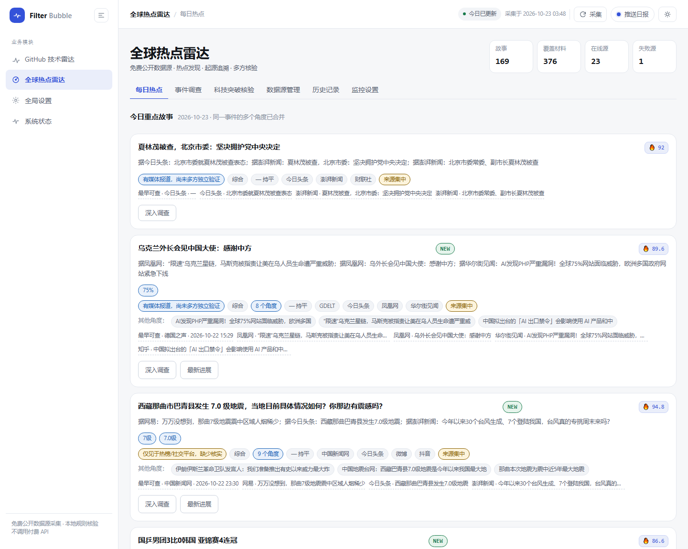
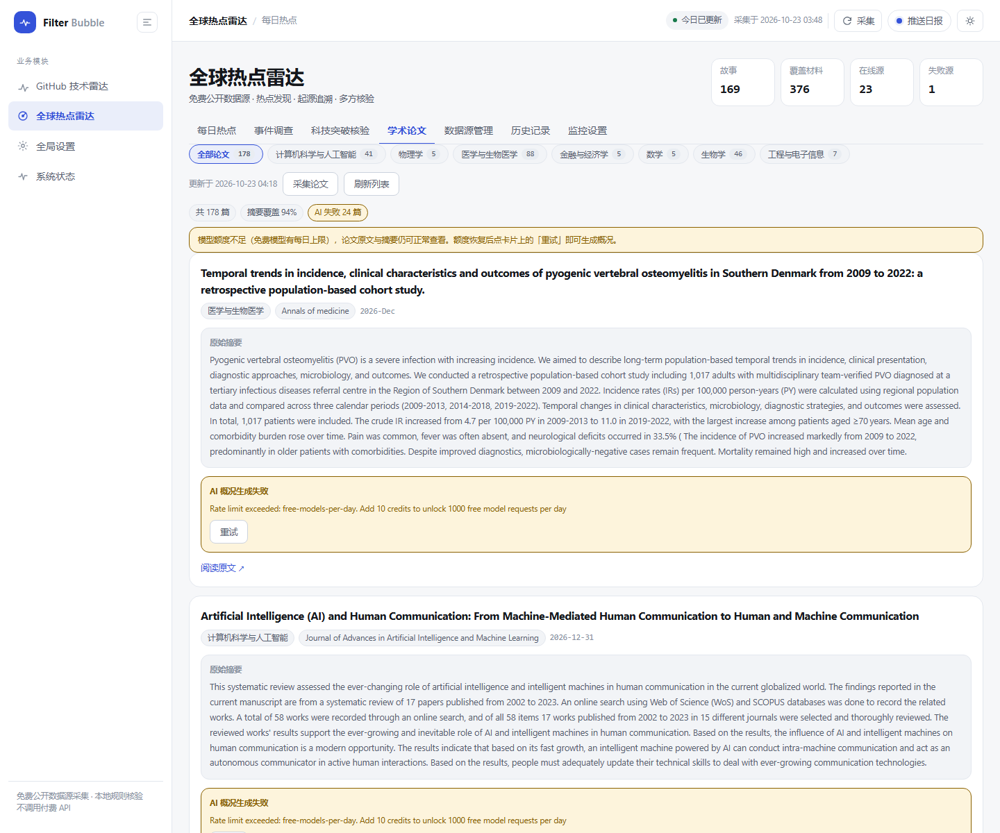
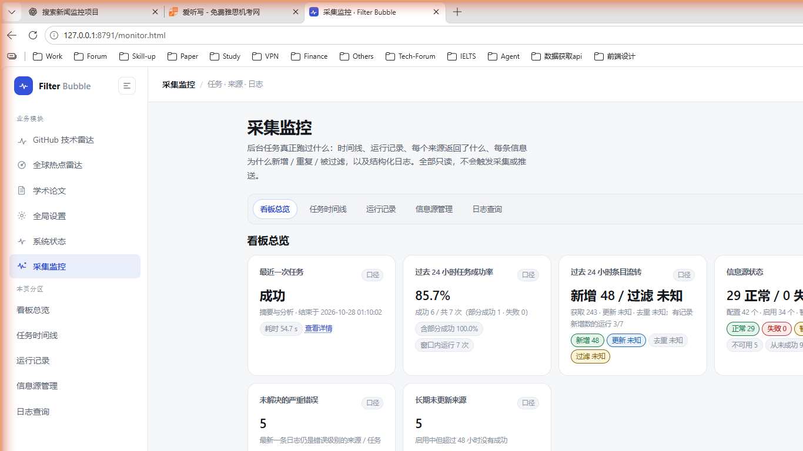
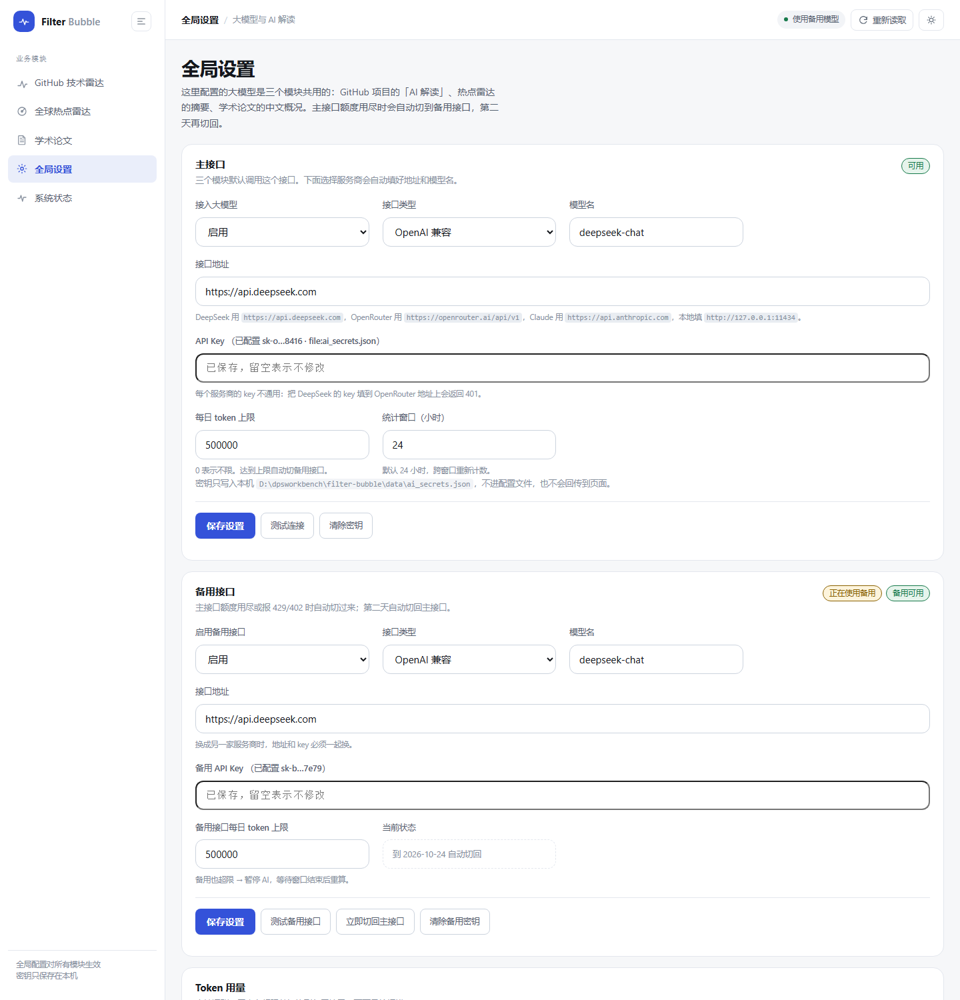

# Filter Bubble · 本地信息雷达

一个**完全本地运行**的信息聚合台，包含四个互相独立的模块，共用一套界面、一套大模型配置和一份 SQLite 数据库：

| 模块 | 入口 | 做什么 |
|---|---|---|
| **GitHub 技术雷达** | `/` | 每日热榜、口味学习、关注发布者、AI 项目速读、收藏夹、微信简报 |
| **全球热点雷达** | `/radar.html` | 33 个数据源的中外新闻聚合、事件聚类、事实核验、交互式世界地图、每日推送 |
| **学术论文** | `/papers.html` | 7 个公开来源的论文抓取与 AI 中文概况 |
| **采集监控** | `/monitor.html` | 后台任务的运行时间线、逐来源结果、逐条流转原因、结构化日志 |

无需登录，无需 API Key，无第三方 Python 依赖。数据只写在本机 `data/filter-bubble.db`。



<p align="center"></p>

---

## 快速开始

```bash
./run.sh                    # 启动界面（首次会自动生成今日日报）
python3 app.py serve        # 等价写法
```

打开 <http://127.0.0.1:8791>。

**环境要求**：Python 3.9+，macOS / Linux / Windows。前端是原生 HTML/CSS/JS，不需要 Node、npm 或构建步骤。

### Windows：开关控制台（`fb.bat`）

双击项目根目录的 **`fb.bat`** 会出来一个菜单：

```
     状态：运行中    PID 34800
     地址：http://127.0.0.1:8791

     [1] 启动            [2] 停止
     [3] 重启            [4] 打开界面
     [5] 看日志          [6] 打开数据目录
     [7] 生成今日日报    [8] 创建桌面快捷方式
     [0] 退出
```

- 菜单顶部实时显示状态；**[1] 启动**会后台拉起服务并打开界面，**[2] 停止**只结束「占用本项目端口 + 是本项目 `runtime\python` 的进程」。
- **[8]** 在桌面创建快捷方式，以后双击桌面图标即可。
- 每次启动会把上一轮日志轮换成 `data\serve.prev.*.log`，当前日志是 `data\serve.*.log`。

也可以带参数调用（适合做快捷方式 / 开机自启）：

```bat
fb.bat start      :: 启动并打开界面（加 -NoBrowser 则不开浏览器）
fb.bat stop       :: 停止
fb.bat restart    :: 重启
fb.bat status     :: 状态（运行中退出码 0，已停止 1）
fb.bat open       :: 只打开界面
fb.bat log        :: 看最近日志
```

> 端口按 `.env` 的 `GITPULSE_PORT`（默认 `8791`）识别；脚本优先用 `pwsh`，没有则退回 Windows PowerShell 5.1。
> 根目录的 `start.bat` 仍然可用：前台运行，关掉窗口即停，适合看实时输出。

### 从其它设备访问（Tailscale）

默认只监听 `127.0.0.1`。两台设备在同一 tailnet 时：

```bash
python app.py serve --host 0.0.0.0
# 或写进 .env 长期生效：GITPULSE_HOST=0.0.0.0
```

Windows 还需要放行防火墙（只对 tailnet）：

```powershell
scripts\open-tailnet.cmd                                   # 双击，会弹 UAC
powershell -ExecutionPolicy Bypass -File scripts\open-tailnet.ps1 -Check   # 只查看，不改
powershell -ExecutionPolicy Bypass -File scripts\open-tailnet.ps1 -Remove  # 撤销
```

它只放行 `100.64.0.0/10`（Tailscale 网段），局域网和公网仍然访问不到。

> 如果 `tailscale ping` 通但 `IP:8791` 超时：通常是 Windows 第一次弹「是否允许 Python 访问网络」时点了取消，系统留下一条**入站 Block 规则**。Block 优先级高于 Allow，必须先用上面的脚本删掉它。

更省事的做法是用 Tailscale 自带代理（不用改防火墙，自带 HTTPS 证书）：

```bash
tailscale serve --bg 8791
tailscale serve status    # 给出 https://<机器名>.<tailnet>.ts.net/
```

**安全提示**：本程序没有登录体系，能访问端口的人就能改配置、触发采集、推送微信。不要把它直接暴露到公网。

---

## 界面

| 入口 | 地址 | 内容 |
|---|---|---|
| GitHub 技术雷达 | `/` | 今日榜单、卡片/列表视图、口味画像、关注动态 |
| 全球热点雷达 | `/radar.html` | 每日热点、事件调查、科技核验、数据源管理、历史、全球态势、监控设置 |
| 学术论文 | `/papers.html` | 按学科浏览论文、原始摘要、AI 中文概况、来源状态 |
| 全局设置 | `/settings.html` | 模型接口列表（1..N 个）、服务商预设与 Key、连接测试、额度用量、错误日志 |
| 系统状态 | `/status.html` | 各模块运行状态、数据源健康、最近运行记录 |
| 采集监控 | `/monitor.html` | 运行时间线、逐来源与逐条明细、结构化日志（只读） |
| 收藏夹 | `/bookmarks.html` | 文件夹分类与搜索 |

- **三态主题**：浅色 / 深色 / 跟随系统，顶栏一键切换并记住选择；也可用 `?theme=dark` 指定。
- **响应式**：≥1240px 双栏；≤1080px 单栏；≤860px 侧栏变抽屉；≤560px 单列。
- **无外部依赖**：没有 CDN、没有构建、没有前端框架；核心界面断网也能显示（除头像）。

设计令牌、组件清单、新增模块的接入步骤见 [docs/ui.md](docs/ui.md)。

---

## 模块一：GitHub 技术雷达

### 三路数据

| 信号 | 来源 | 作用 |
|---|---|---|
| 日榜 | `github.com/trending?since=daily` | 今天最多人看的项目、`stars today` |
| 周榜 | `github.com/trending?since=weekly` | 持续走热、不是一日游的项目 |
| 新星 | GitHub Search，近 7 / 30 天创建、按 star 排序 | 突然冒出来的新项目 |

合并去重后用 GitHub API 补齐 topics、创建时间、License，再按热度选 30 个进入日报。每日 stars 会写入 `snapshots` 表，为后续的加速度判断留下真实历史。

### 热度怎么算

`heat` 是 0–100 的相对分，不是 GitHub 官方数据：

```
heat = 52% × 增速分位
     + 23% × 项目体量分位（log stars）
     + 15% × 新鲜度（按创建时间衰减）
     + 10% × 日榜排名
     + 4   基础分
```

`surge`（「热度猛增」标签）额外考虑今日 star 相对项目总量的占比与当日分位。「日榜第一 / 日榜前三 / 增速冠军 / 新星崛起 / 持续走热 / 上升中」是不同维度的徽章，避免只看一个总榜。

### 口味模型

每个项目被拆成可读特征：`lang:python`（语言）、`cat:ai`（领域）、`topic:llm`、`kw:agent`（白名单过滤后的关键词）、`age:new` / `size:huge` / `heat:surge`（阶段特征）。

反馈（`+1 / -1 / 撤销`）追加到 `feedback` 表。每次反馈后用**逻辑回归**从零重放所有有效样本：

- 学习率 0.5、L2 正则、14 轮，小样本也能快速收敛；
- 少于 3 次评价时保持冷启动，只按热度排序；
- 激活后排序为 **56% 热度 + 44% 个人匹配**；
- 没有正向匹配的项目进入「探索位」，避免信息茧房；
- 一次 👎 不会立刻判定为「永久讨厌」；画像里只展示至少出现过 2 次的负向特征。

所有特征、权重、证据数都在「我的口味」抽屉里可见。点「清空口味记忆」会删除反馈与权重，榜单立即回到热度排序。

### 关注发布者

关注按钮在每张卡片的作者名旁。关注后「关注」视图会汇总这位发布者近 14 天的 GitHub Release 和新建公开仓库。

想关注的人不在榜单里也没关系：关注视图顶部可以按名字搜 GitHub 用户或组织。抓取优先走公开 Atom feed（不消耗 API 配额），组织账号的 user feed 为空时会额外读已知仓库的 releases feed。每 20 分钟最多刷新一次，最多关注 20 位。

### 项目速读

每张卡片的「项目速读」由大模型读一遍项目后写出：一句话是什么 / 项目解读 / 值得注意 / 局限与注意。

没有配置模型、调用失败或额度用尽时，**不编造解读**，直接显示 GitHub 上的项目简介，并在弹窗顶部标明来源：

| 标识 | 含义 |
|---|---|
| `AI 解读 · 模型名` | 这条解读是大模型写的 |
| `GitHub 简介` | 没走大模型，直接显示项目简介 |



### 收藏夹

卡片右上角的书签图标把项目收进「我的收藏」，同时存下简介、语言、star、topics —— 项目掉出当日榜单后收藏里照样能看到。

- 新建 / 改名 / 删除文件夹；删文件夹不会删收藏，只会回到「未分类」；
- 在收藏里按名称、简介、语言、topics 搜索。

### 微信简报

日报生成成功后，把一份手机简报推送到微信（Server酱 Turbo）。只挑 3 个项目（可配 1–5），每个讲清楚：是什么、项目解读、值得注意、局限、来源标识、GitHub 链接。

**推送开关**在「全局设置 → 微信推送」：关掉后连手动「立即推送一次」也不会发。开关状态和最近发送结果在「系统状态」页。

```bash
python3 app.py push --dry-run    # 先预览，不消耗额度
python3 app.py push              # 确认后发送
```

`push_log` 表记录每天是否已发送，同一天不会重复推送。请使用 Server酱 **Turbo** 的 `SCT...` SendKey（微信通道），不要用 Server酱³ 的 `sctp...` key（那是独立 App 通道）。免费额度每天 5 条。

---

## 模块二：全球热点雷达

入口 `/radar.html`。监控中文互联网、国际新闻和可免费访问的公开信息，自动聚类热点，支持事件起源追溯、事实主张拆解、多方证据核验、国内外报道对比和每日推送。



- **两级聚合**：材料先聚成「事件」，事件再按稀有词共现聚成「故事」，日报按故事排。同一个地震的 7 个角度会合并成一条，而不是 7 条。
- **价值过滤**：噪音词、互动门槛、热榜截断三重过滤。
- **排名轨迹**：每次采集记录每条材料在榜单上的位次，日报标「↑ 升温 / ↓ 降温 / — 持平 / 新上榜」。
- **去重先归一化 URL**：剥掉 `band_rank`、`log_pb`、`utm_*` 等每次都变的参数再算哈希。
- **完全独立**：`radar_*` 表、独立调度线程（每小时采集、每天 08:00 出日报并推送）、独立推送配置与去重日志。
- **诚实标注**：仍然无法访问的平台会明确显示「未接入 / 受限」，不伪造数据；调查找不到来源就写「尚未找到最早来源」，证据不足就写「证据不足」。

### 33 个数据源

| 类型 | 数量 | 代表 |
|---|---|---|
| RSS | 13 | 中国新闻网（滚动/国内/国际）、新浪新闻、IT之家、量子位、BBC 中文/世界、德国之声、The Guardian、Al Jazeera、NPR、TechCrunch |
| 热榜 | 9 | 微博、百度、B站、今日头条、网易、V2EX、抖音、知乎、贴吧 |
| API | 8 | Hacker News、GDELT、华尔街见闻、财联社、澎湃、凤凰网、AnySearch（2 个查询） |
| 地理图层 | 3 | USGS 地震、NASA EONET、GDACS —— 只进地图，不进新闻聚类 |

另有 9 个平台默认关闭并标注原因：arXiv（本机 TLS 证书链缺中间证书）、Reddit / Bluesky（本机 403）、X / 小红书 / Instagram / Threads / TikTok（没有合规的免费公开入口，系统不会绕过登录、验证码或访问控制）。

抖音、知乎、贴吧、华尔街见闻、财联社、澎湃、凤凰这些没有可直连公开接口的平台，通过第三方聚合 API（newsnow）接入；返回的每条链接都要匹配预期域名，不匹配直接丢弃。

**AnySearch** 是可选源：`queries` 里每条查询 = 一个发现源，和 RSS 源平级；调查阶段也可用它补外部取证。一次最多返回 10 条、限流窗口 20 次，所以发现源默认 4 小时才跑一次。它的结果标记为 `search` 类型，**不参与「独立来源」计数**——同一篇通稿的几家转载站很容易被算成「3 个独立域名」。

**自定义 RSS 源**：在 `social_radar.json` 的 `rss.feeds` 里加一行 `{id, name, url}` 就多一个源，不用改代码。

### 熔断与自愈

- 连续失败 3 次 → 降频（每 60 分钟才重试一次）；
- 连续失败 6 次 → 自动停用；
- 停用**不是永久的**：冷却 180 分钟后自动放行一次试探性重试，成功即恢复，失败继续等下一个冷却窗口；
- 也可以在「数据源管理」点「重置失败计数」立即解除。

每次采集都会记录每个来源的 HTTP 状态、耗时、错误与本次入库条数，这些数据在「采集监控」和「系统状态」页可见。

### 全球态势：交互式世界地图

第 7 个标签页「全球态势」把事件放到一张可交互的世界地图上，配五个面板。**没有 CDN、没有瓦片服务**，断网也能用。

- 底图是本地矢量（Natural Earth，由 `scripts/build-basemap.py` 生成 `web/world-110m.js`），运行时零外部请求；
- 滚轮缩放 / 拖拽平移 / 双击放大，缩小时点位聚合成数字气泡，点击气泡会放大展开；
- 三种定位精度用不同形状区分：来源坐标（实心圆+外环）、地名匹配（实心圆）、国家级近似（菱形+虚线）；
- 地图与情报流双向联动；灾害点按类型分开关，面几何按真实范围绘制。

| 面板 | 内容 |
|---|---|
| Threat Timeline | 过去 7 天威胁活动与情报可信度两条独立曲线；历史不足时如实显示可用天数，不插值 |
| Strategic Risk | 综合估算值（明确标注「非官方指数」）+ 三个分项 + 权重 + 缺失输入 |
| Country Index | 基于公开媒体可观测事件的紧张度；样本不足的国家不给分数 |
| Intelligence Feed | 复用日报里已聚好的故事，可直接进入事件调查 |
| Live News | 近实时新闻流，`before_id` 翻历史、`since_id` 拉新增 |

地理位置来自 `core/geo/`（国家表 + 地名库），**离线**识别，按顺序尝试：来源坐标 → 地名匹配 → 国家质心 → 无法判断就不显示。标题里出现两个以上国家、或体育队名/跨国评论时不强行锚定。报道来源国与事件发生国分开存储，不混用。

详细的数据源实测、评分公式、调查方法与已知限制见 [docs/radar.md](docs/radar.md)。

---

## 模块三：学术论文

入口 `/papers.html`。按学科浏览近期公开论文，每篇只展示：标题、原始摘要、原文链接、AI 中文概况。



- **7 个来源**：Crossref、PubMed、Europe PMC、bioRxiv、medRxiv、HuggingFace 可用；OpenAlex 需要免费 Key（默认关闭，可在配置里开）。
- **8 个学科**：全部 / 计算机与 AI / 物理 / 医学与生物医学 / 金融与经济 / 数学 / 生物学 / 工程与电子信息，按发布日期倒序。
- **每天更新一次**：论文增量本来就慢，不需要像新闻那样每小时抓。
- **AI 概况与摘要分区展示**：研究内容 / 核心方法 / 主要发现 / 研究意义 / 信息局限。没有摘要就显示「该来源没有提供摘要」，不拿标题冒充。
- **缓存优先**：按内容指纹命中，刷新页面、切换学科、重复采集都不会重新分析；失败可单篇重试。
- **单源失败不影响其他来源**：页面底部显示每源的获取数、摘要覆盖、耗时与错误。

```bash
python app.py radar papers test-sources        # 实测论文数据源（真实请求）
python app.py radar papers collect             # 采集论文 + 生成 AI 概况
python app.py radar papers status              # 查看来源与队列状态
```

详细的数据源实测、去重规则与表结构见 [docs/papers.md](docs/papers.md)。

---

## 模块四：采集监控

入口 `/monitor.html`。它回答：后台任务到底跑过什么、每个来源返回了什么、每条信息为什么被新增 / 去重 / 过滤、出错时错误码是什么。



- **只读旁路**：数据全部来自 `GET /api/monitor/*`，页面不会触发采集、聚类、推送或写库（`POST /api/monitor/*` 一律 405）。监控写入失败只丢监控数据，不影响采集本身。
- **看板**：最近一次任务结果、24 小时成功率、条目流转、信息源状态、未解决的严重错误；历史不全时显示「未知」而不是 0。
- **时间线**：24 小时 / 7 天 / 30 天的真实运行，按任务类型分组；点条块或列表行打开抽屉，看阶段时间线、逐来源结果、逐条处理结果与本次日志。
- **阶段说实话**：只显示本次真的执行过的阶段，没执行的标成「已跳过 / 不适用 / 未知」，绝不显示成成功。
- **信息追踪**：标题、原始链接、来源、发布时间、采集时间、处理动作、被过滤或去重的原因、`item_id` / `event_id` / `story_id`，以及这条信息现在还能不能在雷达里找到。
- **来源管理**：区分「配置存在 / 当前启用 / 最近成功 / 具有新数据」四个概念；**返回 0 条算成功，不等于失败**。
- **日志**：按时间 / 等级 / 任务 / run_id / source_id / 阶段 / 错误码 / 关键词筛选，分页 + 增量追加，点开看脱敏后的 `details_json`。

数据来自两处真实来源：`core/monitor/instrument.py` 的实时埋点，以及把已有历史（`radar_runs`、`paper_source_runs`、`digests`、推送日志）幂等投影进监控表。监控表默认保留 45 天。

接口、统计口径与验收步骤见 [docs/monitor.md](docs/monitor.md)。

---

## 网络与代理

**这一节是重点：项目不需要你为它配置代理，开不开 VPN 都能跑。**

请求层在 `core/net.py`，所有出网（新闻采集、GitHub、翻译、微信推送、大模型）都走它。

### 为什么以前会「所有源一起挂」

以前每个模块都直接调 `urllib.request.urlopen`，而 urllib 默认跟随系统 / 环境变量里的代理。一旦那个本地代理端口没人监听（VPN 退出、Clash 重连、终端里的临时代理失效），**所有**域名都会立刻返回 `WinError 10061 目标计算机积极拒绝` —— 包括本来根本不需要代理的国内站点。随后熔断器把每个源记满 6 次失败并自动停用，网络恢复后也不会自己回来。

### 现在的行为

| 模式 | 行为 |
|---|---|
| `auto`（默认） | 系统有代理就先用代理；代理不通立刻换直连；两个都失败才算失败 |
| `system` | 只跟随系统 / 环境变量代理 |
| `direct` | 强制直连 |
| `manual` | 只用 `network.proxy` 指定的代理 |

- 只有**连接级**失败（拒绝连接、超时、DNS、TLS、代理 407/5xx）才换路由；HTTP 4xx/5xx 是站点给的答复，原样返回，不重试。
- 失败的出口进入冷却（拒绝连接 120 秒、超时 30 秒），期间优先用另一个出口，不会每个请求都白等一次。
- 系统代理每 60 秒重新探测一次，所以**运行中开关 VPN 也能自动适配**，不用重启。
- 数据源管理页会显示当前实际使用的出口，例如「当前出网：直连（direct → system，模式 auto）」。

配置写在 `social_radar.json`：

```json
{
  "network": {
    "mode": "auto",        // auto | system | direct | manual
    "proxy": ""            // mode=manual 时生效，例如 http://127.0.0.1:7890
  }
}
```

也可以用环境变量 `FB_PROXY_MODE` / `FB_PROXY_URL` 覆盖。

> 需要说明的边界：境外站点（BBC、Guardian、Al Jazeera 等）能不能抓到，取决于你本机到它们的网络路径。**没有可用代理时它们会失败，但只影响它们自己**——国内源照常工作，也不会再拖垮整个采集。

---

## 大模型（全局配置）

GitHub 的 AI 解读、热点雷达的摘要、学术论文的概况共用同一套接口、模型与密钥。入口在左侧导航 **全局设置**。



**接口是 1..N 个有序列表**，按优先级依次尝试，全部不可用才停。

| 预设 | 协议 | 地址 | Key 特征 | 额度习惯 |
|---|---|---|---|---|
| DeepSeek 官方 | OpenAI 兼容 | `https://api.deepseek.com` | `sk-...` | 每天 |
| 百度千帆 Token Plan（个人版） | OpenAI 兼容 | `https://qianfan.baidubce.com/v2/tokenplan/personal` | `bce-v3/...` | 套餐（窗口 / 总量） |
| 百度千帆（按量计费） | OpenAI 兼容 | `https://qianfan.baidubce.com/v2` | `bce-v3/...` | 每天 |
| OpenRouter | OpenAI 兼容 | `https://openrouter.ai/api/v1` | `sk-or-...` | 每天 |
| 阿里云百炼 / Moonshot / 智谱 / 火山方舟 / 硅基流动 / OpenAI | OpenAI 兼容 | 见预设 | 各家自己的 | 每天 |
| Anthropic (Claude) | Claude 原生（`/v1/messages` + `x-api-key`） | `https://api.anthropic.com` | `sk-ant-...` | 每天 |
| 本地模型 | Ollama / vLLM 的 `/api/chat` | `http://127.0.0.1:11434` | 不需要 | 不限 |

地址支持以 `/v1` `/v2` `/v3` `/v4` 结尾，也可以直接填完整端点；没有版本号时自动补 `/v1`。

**Key 归属（key_ref）**：Key 按服务商分开保存，换地址不会把上一家的 Key 带过去（401 的头号原因就是这个）。填 Key 时会检查前缀，例如把 `sk-or-...` 填到 DeepSeek 地址上会立刻提示。刚保存过 Key 的接口会自动做一次真实自检。

### 失败分类与额度

- 每个接口有自己的额度规则，三种模式：**每日**（自然日 0 点清零）、**窗口**（每 N 小时刷新，套餐常见）、**总量**（累计抵扣，用完为止，可选重置周期）；
- **配置类**失败（401 无效 Key、403 无权限、404 模型不存在）→ 该接口冷却 30 分钟并标红，期间不再每次白跑一条 401；
- **额度类**失败（402、`quota_exceeded`、`account_overdue`、本地计数达上限）→ 按该接口的额度窗口冷却，换下一个接口；
- **瞬时限流**（429）→ 读 `Retry-After` 退避重试，然后换下一个接口，不做长时间冷却；
- **内容安全**类 403 只针对当次请求，不改变接口状态；
- 所有接口都不可用 → 暂停 AI，窗口结束后自动恢复并重新计数，也可以「立即恢复」。

状态写在 `data/ai_state.json`，用量写在 `data/ai_usage.json`（均已 gitignore）。「Token 用量」面板有每个接口的进度条和最近 15 天的多线折线图。

**这是整个应用里唯一的 AI 成本闸门**：论文概况、GitHub 解读、雷达摘要、收藏夹解读都没有自己的次数上限，全部受接口额度约束。

### 常见失败原因

| 现象 | 含义 | 处理 |
|---|---|---|
| 401 `api key: ****xxxx is invalid` | **Key 与地址不是同一家**（最常见） | 选对应预设，把 Key 填到该服务商自己的 key_ref 下 |
| 403 `account_overdue` / 429 `quota_exceeded` | 账号欠费或套餐额度用尽 | 充值，或等窗口刷新；也可以换下一个接口 |
| 403 `token_plan_person_model_not_supported` | 千帆 Token Plan 个人版不含这个模型 | 换成套餐内的 GLM / DeepSeek 系列 |
| 403 `unsafe_request` | 内容被安全策略拦截 | 与 Key 无关，只影响这一次 |
| 429 `temporarily rate-limited upstream` | 免费模型的上游共享池被限流 | 等 1–2 分钟重试，或换一个模型 |
| `model not found` | 模型名写错 | 用服务商文档里的精确 ID |

配置写在 `app_settings.json`（version 2）：

```json
{
  "version": 2,
  "llm": {
    "enabled": true,
    "timeout_seconds": 90, "max_attempts": 2,
    "slots": [
      { "id": "primary", "name": "主接口", "enabled": true, "preset": "deepseek",
        "provider": "openai", "base_url": "https://api.deepseek.com",
        "model": "deepseek-chat", "key_ref": "deepseek", "priority": 1,
        "quota": { "mode": "daily", "limit": 500000, "window_hours": 24 } }
    ]
  }
}
```

密钥只存本机 `data/ai_secrets.json`（已 gitignore），配置文件里只有 `key_ref`、没有 Key，接口也只返回掩码。环境变量优先：`primary` → `RADAR_LLM_API_KEY`，其它 → `RADAR_LLM_API_KEY_<KEY_REF>`。

---

## 配置

### 环境变量

| 变量 | 默认值 | 说明 |
| --- | --- | --- |
| `GITPULSE_PORT` | `8791` | 本地端口（前缀保留 `GITPULSE_` 以兼容旧配置） |
| `GITPULSE_HOST` | `127.0.0.1` | 改成 `0.0.0.0` 才能被同 tailnet / 局域网的设备访问 |
| `GITPULSE_REFRESH_TIME` | `08:00` | 每日刷新时间 |
| `GITPULSE_TIMEZONE` | `Asia/Shanghai` | 时区 |
| `GITPULSE_MAX_ITEMS` | `30` | 日报条数 |
| `GITPULSE_TRANSLATE` | `1` | 设为 `0` 关闭中文翻译 |
| `GITHUB_TOKEN` | 空 | 可选，提升 GitHub API 限额（60/h → 5000/h） |
| `SERVERCHAN_SENDKEY` | 空 | Server酱 Turbo SendKey（`SCT...`），也可写在 `.env` |
| `GITPULSE_PUSH_ITEMS` | `3` | 微信简报包含几个项目（1–5） |
| `ANYSEARCH_API_KEY` | 空 | 可选，AnySearch 统一搜索引擎的 Key |
| `FB_PROXY_MODE` | `auto` | 出网模式，见「网络与代理」 |
| `FB_PROXY_URL` | 空 | `mode=manual` 时使用的代理地址 |

```bash
GITPULSE_PORT=9000 GITPULSE_REFRESH_TIME=09:00 ./run.sh
```

### `social_radar.json` 关键段

```json
{
  "schedule": { "daily_time": "08:00", "collect_interval_minutes": 60 },
  "network": { "mode": "auto", "proxy": "" },
  "backoff": {
    "degrade_after": 3, "degrade_interval_minutes": 60,
    "pause_after": 6, "resume_after_minutes": 180
  },
  "filters": {
    "rules": ["[科技]", "+芯片", "+半导体", "!抽奖", "/\\b(llm|gpt)\\b/ => 大模型", "@8"]
  },
  "rss": {
    "feeds": [
      { "id": "hn", "name": "Hacker News", "url": "https://hnrss.org/frontpage",
        "language": "en", "max_items": 20 }
    ]
  },
  "anysearch": {
    "enabled": false,
    "api_key_env": "ANYSEARCH_API_KEY",
    "min_interval_minutes": 240,
    "queries": [
      { "id": "ai", "name": "AI 与大模型", "query": "AI 大模型 最新进展 突破" }
    ]
  },
  "papers": { "enabled": true, "daily_time": "08:30", "interval_hours": 24 },
  "push": { "enabled": false, "items": 5 }
}
```

关键词语法一行一条：

| 写法 | 含义 |
|---|---|
| `[组名]` | 新开一组，组内规则互相独立 |
| `+词` | 必须命中（组内多个 `+` 命中任一即可） |
| `!词` | 命中即排除，优先级最高 |
| `/正则/` | 正则匹配，可带 `=> 别名` |
| `@数字` | 该组最多保留多少条 |

AnySearch 的 `tag` 留空 = 通用网页搜索；也可以换成垂直域（`academic.search`、`code.doc`、`finance.quote`、`security.intel` 等）。**部分子域有必填参数**（`finance.quote` 要 `type`），要一起写进 `params`，否则后端判 400。

### 翻译

中文简介使用 [MyMemory](https://mymemory.translated.net/) 公共接口，不需要 Key，每天约 5000 字符匿名额度。翻译结果永久缓存在 `translations` 表，同一项目第二天不会重复消耗额度。额度用尽或服务不可达时，卡片自动回退到英文原文——不报错，也不阻塞日报。

### GitHub API 限额

未登录时 GitHub REST API 为 60 次/小时。一次完整生成通常消耗 30 次左右；项目详情缓存 24 小时、README 缓存 7 天，所以后续刷新基本不消耗详情额度。频繁手动刷新建议配置 `GITHUB_TOKEN`。

---

## API

### 日报与口味

| 方法 | 路径 | 说明 |
| --- | --- | --- |
| GET | `/api/digest` | 今日日报（未生成时返回 202） |
| GET | `/api/status` | 生成状态、下次运行时间 |
| POST | `/api/refresh` | 触发后台重新抓取 |
| POST | `/api/feedback` | `{repo, signal: 1 / -1 / 0}` |
| POST | `/api/rerank` | 按当前模型重排 |
| POST | `/api/reset` | 清空口味记忆 |
| GET | `/api/prefs` | 当前偏好画像 |
| POST | `/api/brief` | 单个项目的 AI 速读 |
| POST | `/api/seen` | `{kind: github\|radar, keys: []}`，标记 NEW 已读 |

### 收藏与关注

| 方法 | 路径 | 说明 |
| --- | --- | --- |
| POST | `/api/bookmark` | `{repo, folder_id?}`，切换收藏 |
| GET | `/api/bookmarks` | `?folder=all\|none\|<id>&q=关键词` |
| POST | `/api/bookmarks/folder` | `{action: create\|rename\|delete, id?, name?}` |
| POST | `/api/bookmarks/move` | `{repo, folder_id}` |
| GET | `/api/follows` | 关注列表 + 发布动态（`?refresh=1` 强制刷新） |
| GET | `/api/follows/search` | `?q=关键词`，搜 GitHub 用户/组织 |
| POST | `/api/follow` | `{owner}`，关注/取消关注 |
| POST | `/api/follows/refresh` | 刷新全部关注 |

### 大模型与推送

| 方法 | 路径 | 说明 |
| --- | --- | --- |
| GET | `/api/ai/status` | 接口健康、额度、冷却状态 |
| GET | `/api/ai/settings` | 当前模型配置（Key 已掩码） |
| GET | `/api/ai/presets` | 服务商预设列表 |
| GET | `/api/ai/usage` | Token 用量与历史曲线 |
| GET | `/api/ai/errors` | 最近的调用错误 |
| POST | `/api/ai/test` | 测试指定接口 |
| POST | `/api/ai/health/test-all` | 逐个测试全部接口 |
| POST | `/api/ai/health/reset` | 清除冷却 |
| POST | `/api/ai/resume` | 立即恢复暂停的 AI |
| POST | `/api/ai/clear-key` | 清除某个 key_ref 的 Key |
| GET / POST | `/api/push` | 微信简报状态 / `{force}` 发送 |

### 全球热点雷达

| 方法 | 路径 | 说明 |
| --- | --- | --- |
| GET | `/api/radar/status` | 雷达状态、调度、数据源统计、当前出网出口 |
| GET | `/api/radar/report` | 指定日期日报 |
| GET | `/api/radar/events` | 事件列表 |
| GET | `/api/radar/event` | 单个事件详情 |
| GET | `/api/radar/sources` | 数据源列表 + 健康 + 出网状态 |
| GET | `/api/radar/history` | 历史日报、调查与运行记录 |
| GET | `/api/radar/settings` | 雷达配置（脱敏） |
| POST | `/api/radar/collect` | 触发采集 |
| POST | `/api/radar/report` | 只生成日报 |
| POST | `/api/radar/sources/reset` | 重置失败计数（`{source_id?}`，空 = 全部） |
| POST | `/api/radar/investigate` | `{event_id}` 或 `{query}` |
| GET | `/api/radar/investigation` | 历史调查报告 |

### 全球态势

| 方法 | 路径 | 说明 |
| --- | --- | --- |
| GET | `/api/radar/intel` | 五个面板 + 地图，一份数据 |
| GET | `/api/radar/intel/threat` | 威胁时间线 |
| GET | `/api/radar/intel/countries` | 国家指数 |
| GET | `/api/radar/intel/map` | 地图点位（`?hazards=earthquake`） |
| GET | `/api/radar/intel/live` | 实时新闻（`?since_id=` / `?before_id=`） |

### 学术论文

| 方法 | 路径 | 说明 |
| --- | --- | --- |
| GET | `/api/radar/papers` | 按学科列论文 |
| GET | `/api/radar/papers/status` | 来源与队列状态 |
| POST | `/api/radar/papers/collect` | 触发采集 |
| POST | `/api/radar/papers/analyze` | 分析单篇 |
| POST | `/api/radar/papers/analyze-pending` | 分析队列 |
| POST | `/api/radar/papers/retry` | 单篇重试 |
| POST | `/api/radar/papers/retry-failed` | 批量重试失败 |
| POST | `/api/radar/papers/test-sources` | 实测数据源 |

### 采集监控（只读）

`/api/monitor/health`、`/overview`、`/timeline`、`/runs`、`/run`、`/run/items`、`/run/logs`、`/sources`、`/source`、`/logs`、`/log`、`/meta`。全部 `GET`，`POST` 一律 405。

### 命令行

```bash
python app.py serve                      # 启动 UI + 调度
python app.py refresh                    # 生成一次 GitHub 日报
python app.py rerank                     # 按最新模型重排
python app.py push --dry-run             # 预览微信简报
python app.py reset                      # 清空口味记忆
python app.py radar collect              # 采集 + 生成雷达日报
python app.py radar report               # 只生成雷达日报
python app.py radar query 芯片 突破       # 自由关键词调查
python app.py radar investigate <event_id>
python app.py radar papers collect
./scripts/daily-update.sh                # 带网络检测的每日更新
```

`python scripts/collect-now.py --only ithome,qbitai` 可以只跑指定数据源，`--force` 忽略熔断与节流。

---

## 每日自动化

### 方式 A：LaunchAgent（macOS）

```bash
./scripts/install-daily.sh      # 安装
./scripts/uninstall-daily.sh    # 卸载
```

登录时自动启动本地服务，服务常驻：每小时刷新榜单，每天 08:00（Asia/Shanghai）推送微信简报；08:00 断网会每 10 分钟重试，唤醒后补跑当天日报。日志在 `data/launchd.err.log`。

### 方式 B：cron（macOS / Linux）

```cron
0 8 * * * cd /path/to/filter-bubble && /usr/bin/python3 app.py refresh >> data/cron.log 2>&1
```

这种方式只生成数据；要看界面仍需运行 `./run.sh`。

### 方式 C：Windows 计划任务

`scripts/daily-update.cmd` 是 Windows 入口，交给任务计划程序在 08:00 调用即可。

> 服务内部也有调度线程：只要进程活着，每天到点会检查并生成当日日报。所以单纯运行 `./run.sh` 也能实现每日更新。

---

## 目录

```
filter-bubble/
├── app.py                  # HTTP 服务、API、CLI、调度
├── core/
│   ├── net.py              # 统一出网层：代理自动切换 + 失败冷却
│   ├── github.py           # Trending 解析 + Search + API 补全
│   ├── rank.py             # 热度 / 猛增 / 多样性排序
│   ├── prefs.py            # 特征、逻辑回归、偏好画像
│   ├── digest.py           # 生成流水线、持久化、重排
│   ├── translate.py        # MyMemory 翻译 + 额度 + 缓存
│   ├── notify.py           # Server酱微信简报渲染与发送
│   ├── db.py               # SQLite schema 与访问
│   ├── config.py           # 环境变量配置
│   ├── radar/              # 全球热点雷达：采集、聚类、评分、调查、推送、态势
│   │   ├── sources/        # 各平台适配器（RSS / 热榜 / API / newsnow / AnySearch）
│   │   └── ...
│   ├── papers/             # 学术论文：来源、采集、分类、AI 概况
│   ├── geo/                # 离线地名与国家表
│   └── monitor/            # 采集监控：实时埋点 / 只读查询 / 脱敏 / 历史导入
├── web/                    # 原生前端（7 个页面 + 本地世界地图矢量）
├── scripts/                # 启停控制、每日更新、底图与地名构建、按需采集
├── docs/                   # 设计文档与截图
├── data/filter-bubble.db   # 全部本地数据
└── run.sh
```

---

## 已知边界

- 热度是相对分，不是 GitHub 官方指标；不同日期之间的分数不保证绝对可比。
- 免费翻译在专业术语上偶有生硬；英文原文始终保留。
- GitHub 页面结构变化可能影响 Trending 解析；解析失败时保留上一份日报并在界面提示。
- 部分网络环境无法加载 GitHub 头像；前端会自动回退到基于用户名生成的渐变首字母头像。
- 关注动态依赖 GitHub 公开 Atom feed / Release feed；组织账号没有公开 activity 时，可能只能看到新仓库，看不到 release。
- 微信简报只发 3 个项目（可配 1–5），不是完整 30 个；完整内容仍在电脑端。
- Server酱免费额度每天 5 条，发送失败也会计数；调试请用 `--dry-run`。
- 境外新闻源能否采集取决于本机到它们的网络路径；没有可用代理时它们会失败，但不影响国内源。
- GDELT 的公共额度经常返回 429，失败属正常；arXiv 在本机因 TLS 证书链问题默认关闭；Reddit / Bluesky 本机 403。
- 论文的 OpenAlex 来源需要免费 Key，默认关闭。

---

## 隐私

- 服务只监听 `127.0.0.1`，不对外暴露。
- 日报、反馈、权重、雷达与论文数据全部在 `data/filter-bubble.db`。
- 只有「英文项目简介 / README 摘要」会发给 MyMemory 做翻译；关闭 `GITPULSE_TRANSLATE` 后，除 GitHub 之外的网络请求为零。
- 大模型 Key 只存 `data/ai_secrets.json`，不写配置文件、不进仓库，接口只返回掩码。
