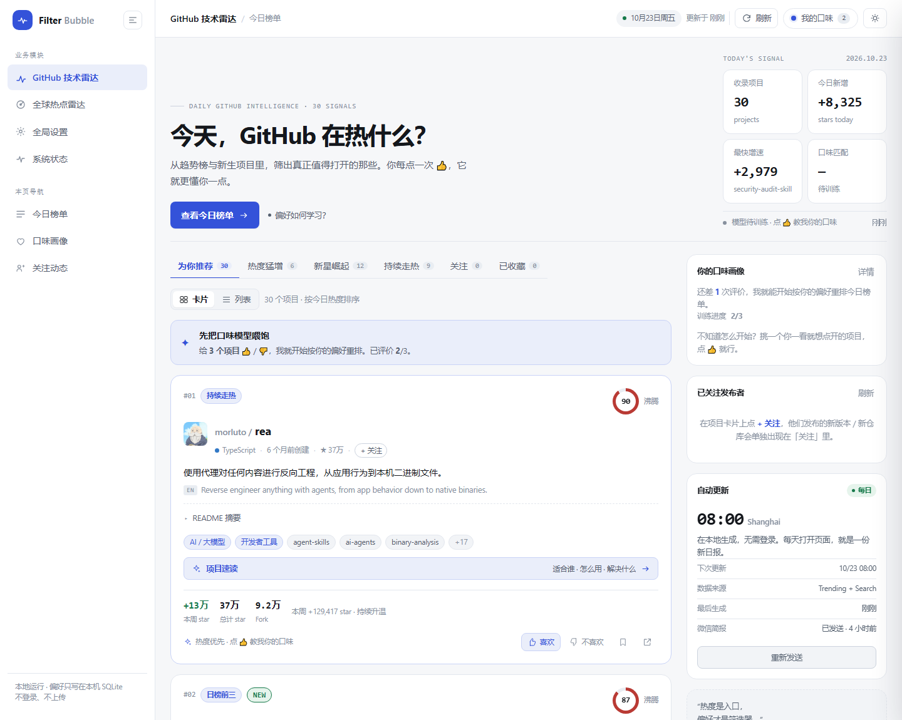
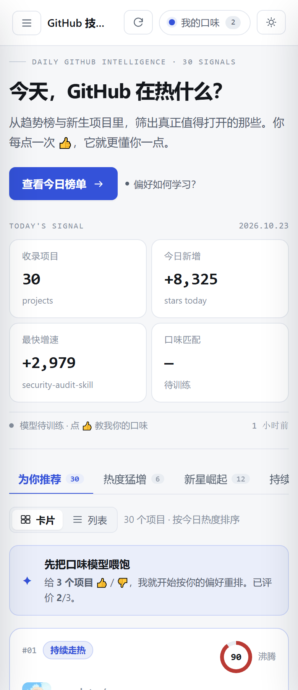
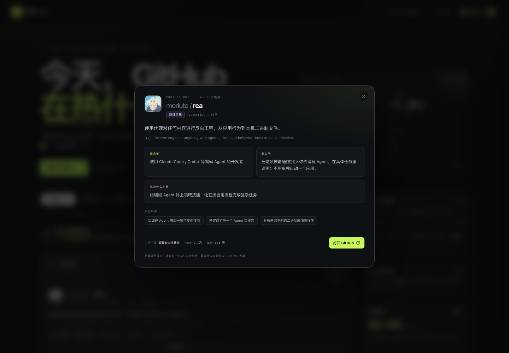
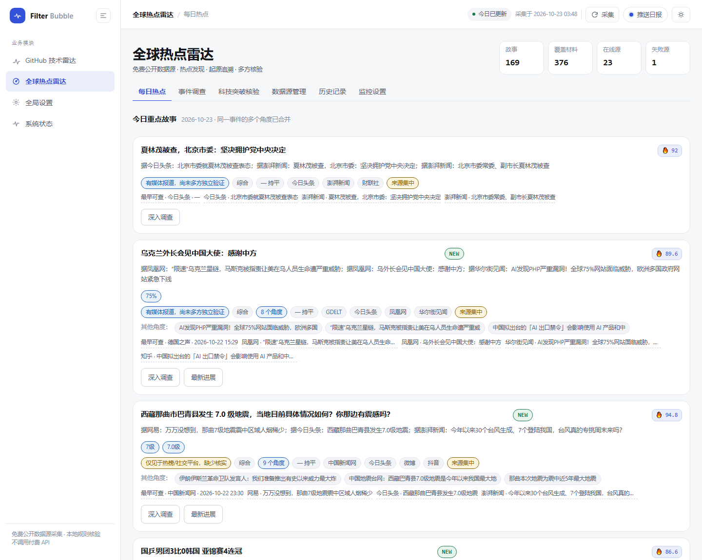
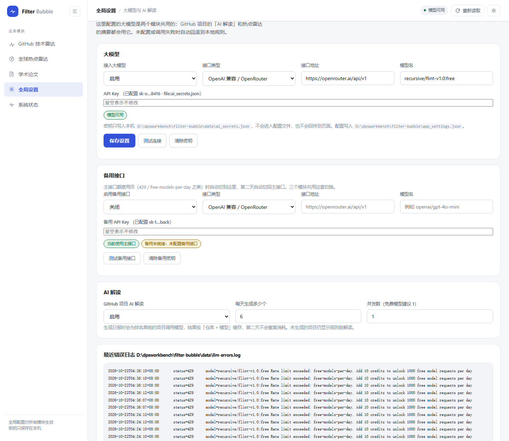
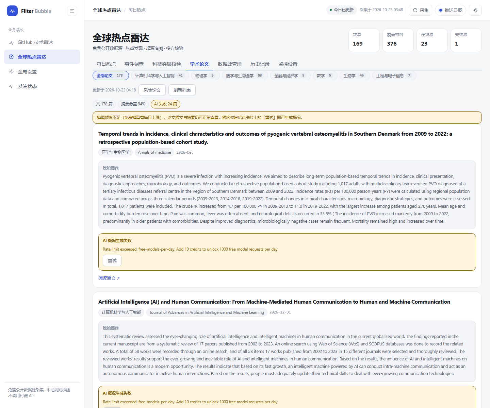

# Filter Bubble · 今日 GitHub 信号

一个**完全本地运行**的 GitHub 每日热榜，重点覆盖四件事：

1. 不只复述 Trending 排名，而是把「今天很热」「涨得很快」「刚冒出来」三种信号分开，再给出热度分、中文简介与项目速读。
2. 它会学习你的口味。每个项目都可以点 **👍 喜欢 / 👎 不喜欢**，模型立即重排今日榜单，并把这些反馈沉淀成一份可解释的偏好画像。
3. 你可以关注喜欢的发布者。他们之后的新 release / 新仓库会进入独立的「关注」视图，不混进每日热榜。
4. 每个项目都有「项目速读」：适合谁、怎么用、解决什么问题、典型场景。

无需登录，无需 API Key，无第三方 Python 依赖。数据与口味模型都只写在本机的 `data/filter-bubble.db`。



<p align="center"></p>

> 截图中的关注与评价仅作界面展示，实际数据以本机为准。

---

## 快速开始

```bash
cd filter-bubble
python3 app.py refresh     # 首次生成今日日报（约 1–2 分钟）
./run.sh                   # 启动界面
```

打开 <http://127.0.0.1:8791>。

也可以直接 `./run.sh`：如果今天还没有日报，它会在后台生成，页面会自动轮询进度。

**环境要求**：Python 3.9+（macOS 自带的 3.9 即可），macOS / Linux / Windows。前端是原生 HTML/CSS/JS，不需要 Node、npm 或构建步骤。

---

## 统一界面

两个业务模块共用一套应用外壳与设计系统：左侧是业务模块导航，顶部是当前页面上下文与主操作，右侧是模块自己的内容区。

| 入口 | 地址 | 内容 |
|---|---|---|
| GitHub 技术雷达 | `/` | 今日榜单、卡片/列表视图、口味画像、关注动态 |
| 全球热点雷达 | `/radar.html` | 每日热点、事件调查、科技核验、数据源、历史、监控设置 |
| 学术论文 | `/papers.html` | 按学科浏览公开论文、原始摘要、AI 中文概况、来源状态 |
| 全局设置 | `/settings.html` | 大模型开关与密钥、连接测试、错误日志、AI 解读参数 |
| 系统状态 | `/status.html` | 各模块的运行状态、数据源健康与最近运行记录（只读） |

- **三态主题**：浅色 / 深色 / 跟随系统，顶栏一键切换并记住选择；也可用 `?theme=dark` 直接指定。
- **卡片 / 列表视图**：同一份数据两种密度，选择会记住。
- **响应式**：≥1240px 双栏；≤1080px 单栏；≤860px 侧栏变成抽屉导航；≤560px 卡片单屏一列。
- **可访问性**：图标按钮有可访问名称，标签页有 `aria-selected`，焦点可见，尊重系统「减少动态效果」。
- **无外部依赖**：没有 CDN、没有构建、没有前端框架；核心界面断网也能显示（除头像）。

设计令牌、组件清单、交互规则、浏览器实测结果和**新增模块的接入步骤**见 [docs/ui.md](docs/ui.md)。

---

## 产品思路

### 1. 三路数据，而不是一张榜

| 信号 | 来源 | 作用 |
| --- | --- | --- |
| 日榜 | `github.com/trending?since=daily` | 今天最多人看的项目、`stars today` |
| 周榜 | `github.com/trending?since=weekly` | 持续走热、不是一日游的项目 |
| 新星 | GitHub Search，近 7 / 30 天创建、按 star 排序 | 突然冒出来的新项目 |

合并去重后，用 GitHub API 补齐 topics、创建时间、License 等信息；再按热度选出 30 个进入日报。

### 2. 热度怎么算

`heat` 是 0–100 的相对分，不是 GitHub 官方数据：

```
heat = 52% × 增速分位
     + 23% × 项目体量分位（log stars）
     + 15% × 新鲜度（按创建时间衰减）
     + 10% × 日榜排名
     + 4   基础分
```

`surge`（用于「热度猛增」标签）额外考虑：

- 今日 star 相对项目总量的占比（小项目一天涨 10% 比大项目涨 1% 更值得注意）；
- 增速在当日候选集中的分位；
- 周榜续航会体现在热度与「持续走热」徽章上。

「日榜第一 / 日榜前三 / 增速冠军 / 新星崛起 / 持续走热 / 上升中」是不同维度的徽章，避免只看一个总榜。

> 每日会把 stars 写入 `snapshots` 表，为后续的加速度判断留下真实历史；GitHub 本身只提供 `stars today`，没有历史曲线。

### 3. 口味模型

每个项目被拆成可读特征：

- `lang:python` — 语言
- `cat:ai` — 领域（AI / 开发工具 / Web / 基础设施 / 数据 / 安全 / 创意 / 系统……）
- `topic:llm` — GitHub topics
- `kw:agent` — 经过白名单过滤的高信号关键词
- `age:new` / `size:huge` / `heat:surge` — 阶段特征

反馈（`+1 / -1 / 撤销`）追加到 `feedback` 表。每次反馈后，用**逻辑回归**从零重放所有有效样本：

```
P(喜欢) = sigmoid(bias + Σ weight[feature])
```

- 学习率 0.5、L2 正则、14 轮，小样本也能快速收敛；
- 少于 3 次评价时保持冷启动，只按热度排序；
- 激活后最终排序为 **56% 热度 + 44% 个人匹配**；
- 没有正向匹配的项目会进入「探索位」，避免信息茧房；
- 一次 👎 不会立刻被判定为「永久讨厌」；画像里只展示至少出现过 2 次的负向特征，防止过拟合。

所有特征、权重、证据数都在「我的口味」抽屉里可见。点「清空口味记忆」会删除反馈与权重，榜单立即回到热度排序。

### 4. 关注发布者

关注按钮在每张卡片的作者名旁。关注后，「关注」视图会汇总这位发布者近 14 天的：

- GitHub Release（版本号 + release notes）；
- 新建的公开仓库。

抓取优先走 GitHub 的公开 Atom feed（不消耗 API 配额）；组织账号的 user feed 经常为空，会额外读取已知仓库的 releases feed。每 20 分钟最多刷新一次，最多关注 20 位发布者。

关注动态和每日热榜是两条独立的数据流：热榜每天重算，关注动态只属于你自己。

### 5. 项目速读与 AI 解读

每张卡片都有「项目速读」。配置了大模型后，内容由模型基于项目简介、语言、topics 与 README 摘要生成；没有配置或调用失败时，自动回退到本地规则版。

打开后显示：

- **适合谁**：目标用户/团队；
- **怎么用**：安装与运行方式（模型不确定时写「README 未说明」）；
- **解决什么问题**：这个方向最常见的痛点；
- **典型场景**：可落地的使用场景；
- **完整使用流程**：从安装、配置到接入的 4 步路径；
- **上手门槛**：需要命令行、Docker、某语言运行环境，或只需阅读；
- **局限与注意**：已知限制（AI 解读会明确写「README 未说明」，不编造）。

内容是**基于项目简介、语言、topics 与 README 摘要的归纳**，界面会明确提示“具体命令与限制以 README 为准”，不假装比 README 更懂项目。



### 6. 微信简报（Server酱）

日报生成成功后，会自动把一份**手机简报**推送到微信。设计目标不是把 30 个项目全部塞进手机，而是只挑 3 个项目，每个讲清楚：

- 是什么
- 解决什么问题
- 适合谁
- 完整使用流程（4 步）
- 典型场景
- GitHub 链接

每个项目单独一段，使用 Server酱 Turbo 的 Markdown 正文。手机端不展示完整 30 个项目，完整榜单仍在电脑端。

配置方式：

```bash
cd filter-bubble
cp .env.example .env
# 编辑 .env，把 SERVERCHAN_SENDKEY 换成 sct.ftqq.com 获取的 SCT 开头 SendKey
./run.sh
```

先预览、不消耗额度：

```bash
python3 app.py push --dry-run
```

确认后发送：

```bash
python3 app.py push
```

`serverchan` 的 `push_log` 表会记录每天是否已发送；同一天不会重复推送。生成日报、`scripts/daily-update.sh` 都会自动尝试推送并重试失败记录。

**注意**：请使用 Server酱 **Turbo** 的 `SCT...` SendKey（微信通道），不要用 Server酱³ 的 `sctp...` key（那是独立 App 通道）。免费额度每天 5 条，正常每天 1 条足够；调试请用 `--dry-run`。

### 7. 界面

- 编辑感深色版面 + 荧光绿信号色；桌面双栏，移动端单栏；
- 顶部总览：收录数、今日新增 star、最快增速、平均口味匹配；
- 六类视图：为你推荐 / 热度猛增 / 新星崛起 / 持续走热 / 关注 / 已收藏；
- 卡片内：热度环、中文简介、英文原文、topics、今日/本周增量、匹配理由，以及「项目速读」入口；
- 反馈后即时重排（FLIP 位移动画），并弹出模型学习提示；
- 口味抽屉展示领域/语言/topic/关键词权重，以及会主动避开的特征。

---

## 全球热点雷达（独立模块）

在同一个应用里新增了第二个模块：**全球热点雷达**，入口是 <http://127.0.0.1:8791/radar.html>，左侧导航可以在「GitHub 技术雷达 / 全球热点雷达 / 全局设置 / 系统状态」之间切换。



它监控中文互联网、国际新闻和可免费访问的公开社交信息，自动聚类热点，并支持**事件起源追溯、事实主张拆解、多方证据核验、国内外报道对比和每日自动推送**。

- **两级聚合**：材料先聚成「事件」，事件再按稀有词共现聚成「故事」，日报按故事排 —— 同一个地震的 7 个角度会合并成一条，而不是 7 条。
- **价值过滤**：噪音词、互动门槛、热榜截断三重过滤，未覆盖材料比例从 72% 降到 24%。
- **数据源熔断**：连续失败 3 次降频、6 次自动停用，可在数据源管理页一键重置。
- **摘要可接大模型**：默认用本地抽取式摘要（直接引用原文标题）。模型在**全局设置**里配置，见下一节；失败会自动回退，不影响日报。

- **完全独立**：新的 `radar_*` 表、独立的 `radar-scheduler` 线程（每小时采集、每天 08:00 出日报并推送）、独立的推送配置与去重日志。原有 GitHub 的采集、筛选、评分、日报、推送和接口一行未改。
- **每小时采集，每天推一次**：两个模块的采集频率都是每小时，微信简报统一在 08:00 发出，避免一天几十条推送。
- **NEW 标签**：每条内容是第一次出现就标 NEW，只有你真的点开「项目速读」或「深入调查」之后才消除；刷新页面、重新排序都不会让标签复活。
- **28 个信源，两种接入方式**：直连适配器（中国新闻网、新浪、IT之家、量子位、微博热搜、百度热搜、B站、今日头条、网易、V2EX、德国之声、Hacker News、TechCrunch、BBC 等）保证数据自持与正文深度；抖音、知乎、贴吧、华尔街见闻、财联社、澎湃、凤凰这些**没有可直连公开接口**的平台，通过第三方聚合 API（newsnow）接入，作为热点发现源。
- **聚合源有域名校验**：第三方返回的每条链接都必须匹配预期域名（`expected_domain`），不匹配直接丢弃，防止数据被篡改。
- **去重先归一化 URL**：剥掉 `band_rank`、`log_pb`、`utm_*` 等每次抓取都变的参数再算哈希，同一条新闻不会因为链接变体重复入库。
- **自定义 RSS 源**：在 `social_radar.json` 的 `rss.feeds` 里加一行 `{id, name, url}` 就多一个源，不用改代码。
- **关键词语法**：`[组名]` 分组、`+必须词`、`!排除词`、`/正则/ => 别名`、`@每组上限`，比一列扁平的排除词更能压住噪音。
- **排名轨迹**：每次采集记录每条材料在榜单上的位次，日报上直接标「↑ 升温 / ↓ 降温 / — 持平 / 新上榜」。
- **全部免费**：不需要任何付费 API 或订阅。
- **诚实标注**：仍然无法访问的平台（X、小红书、Instagram、Threads、TikTok，以及 arXiv、Reddit 的本机网络问题）会明确显示「未接入 / 受限」，不会伪造数据。
- **不编造结论**：调查只使用已采集的公开材料，每条结论都指回具体链接；找不到来源就写「尚未找到最早来源」；证据不足就写「证据不足」。

六个子页面：每日热点 / 事件调查 / 科技突破核验 / 数据源管理 / 历史记录 / 监控设置。

```bash
python app.py radar collect           # 采集 + 生成雷达日报
python app.py radar query 芯片 突破    # 自由关键词调查
```

### 接入大模型（可选）

大模型是**全局配置**：GitHub 项目的 AI 解读和热点雷达的摘要共用同一套接口、模型与密钥。入口在左侧导航 **全局设置**。



| 字段 | 填什么 |
|---|---|
| 接入大模型 | 启用 |
| 接口类型 | OpenAI 兼容 / OpenRouter（或本地 Ollama） |
| 接口地址 | `https://openrouter.ai/api/v1` 或 `http://127.0.0.1:11434` |
| 模型名 | OpenRouter 的模型 slug，例如 `recursive/flint-v1.0:free` |
| API Key | OpenRouter 的 `sk-or-...` |

点 **保存设置** → 点 **测试连接**。测试会真实请求一次，并显示：

- 成功：耗时、模型回显、模型返回的内容片段
- 失败：具体原因（HTTP 状态、上游原始消息、建议）和最近的错误日志

**常见的失败原因**：

| 现象 | 含义 | 处理 |
|---|---|---|
| 429 + “temporarily rate-limited upstream” | 免费模型的上游共享池被限流，**不是 key 的问题** | 等 1–2 分钟重试，或换一个免费模型 |
| 404 + “unavailable for free … use this slug instead” | 该模型已取消免费额度 | 按提示改用付费 slug，或换免费模型 |
| 401 | key 无效或过期 | 重新填写 key |
| 402 | 额度不足 | 检查 OpenRouter 余额 |

> 实测：`google/gemma-4-26b-a4b-it:free` 在当前时段经常被上游限流（429），而 `recursive/flint-v1.0:free` 可以正常返回。OpenRouter 的免费池是共享的，可用性会随时间变化。

### 备用接口（额度用尽自动切换）

免费模型有每日上限，用完后当天的 AI 功能就废了。所以支持配一个备用接口：

- 主接口返回 **额度类错误**（429 / 402 / `free-models-per-day` / `insufficient`）时，自动切到备用接口重试；
- 切换状态写在本机 `data/ai_state.json`，记录「到哪天为止用备用」；
- **第二天自动切回主接口**，不需要手动改配置；
- 全局设置页可以看当前用的是哪个接口、什么时候切回，也能「立即切回主接口」，两个 Key 分开保存。


```json
{
  "llm": {
    "enabled": true,
    "provider": "openai_compatible",
    "base_url": "https://openrouter.ai/api/v1",
    "model": "recursive/flint-v1.0:free",
    "fallback": {
      "enabled": true,
      "provider": "openai_compatible",
      "base_url": "https://api.deepseek.com",
      "model": "deepseek-chat",
      "api_key_env": "RADAR_LLM_API_KEY_FALLBACK"
    }
  }
}
```

两个 Key 分开存：主接口用 `RADAR_LLM_API_KEY` 或 `data/ai_secrets.json` 里的 `llm_api_key`；备用接口用 `RADAR_LLM_API_KEY_FALLBACK` 或同文件的 `llm_api_key_fallback`。切换只影响调用路由，不改变你的配置。

密钥只保存在本机 `data/ai_secrets.json`（已 gitignore），不会写进配置文件，接口也只返回掩码。配置本身写在 `app_settings.json`：

```json
{
  "llm": { "enabled": true, "provider": "openai_compatible",
           "base_url": "https://openrouter.ai/api/v1",
           "model": "recursive/flint-v1.0:free" },
  "ai": { "enable_briefs": true, "briefs_per_run": 12, "concurrency": 1 }
}
```

`ai.briefs_per_run` 控制每天自动为多少个项目生成 AI 解读（默认 12），其余项目可以在「项目速读」里点 **用 AI 重新解读** 按需生成。结果按「仓库 + 模型」缓存，不会重复消耗额度。

不配置或调用失败时，两个模块都会回退到本地规则（GitHub 用规则版解读，雷达用抽取式摘要），日报不受影响。

```json
// social_radar.json（热点雷达自己的配置，不含模型设置）
{
  "schedule": {
    "daily_time": "08:00",              // 每天几点出日报并推送
    "collect_interval_minutes": 60      // 每多少分钟采集一次
  },
  "push": { "enabled": false, "items": 5 },
  "interests": { "topics": ["AI 与大模型", "芯片与半导体"], "keywords": [], "exclude": [] },
  "filters": {
    "rules": ["[科技]", "+芯片", "+半导体", "!抽奖", "/\\b(llm|gpt)\\b/ => 大模型", "@8"]
  },
  "rss": {
    "feeds": [
      { "id": "hn", "name": "Hacker News", "url": "https://hnrss.org/frontpage",
        "language": "en", "max_items": 20 }
    ]
  },
  "scoring": { "velocity": 0.3, "cross_platform": 0.2, "engagement": 0.2,
               "verification": 0.2, "interest": 0.1 }
}
```

关键词语法一行一条：

| 写法 | 含义 |
|---|---|
| `[组名]` | 新开一组，组内规则互相独立 |
| `+词` | 必须命中（组内多个 `+` 命中任一即可） |
| `!词` | 命中即排除，优先级最高 |
| `/正则/` | 正则匹配，可带 `=> 别名` |
| `@数字` | 该组最多保留多少条 |

详细说明（数据源实测结果、评分公式、调查方法、存储结构、已知限制）见 [docs/radar.md](docs/radar.md)。

---

## 学术论文（独立模块）

左侧导航的第三项，与「GitHub 技术雷达」「全球热点雷达」同级，入口 `/papers.html`。



按学科浏览近期公开论文，每篇只展示：**标题、原始摘要、原文链接、AI 中文概况**。

- **7 个来源实测**：Crossref、PubMed、Europe PMC、bioRxiv、medRxiv、HuggingFace 可用；OpenAlex 需要免费 Key；**arXiv 因本机 TLS 证书链缺中间证书暂不可用**（没有关闭校验绕过）
- **8 个学科**：全部 / 计算机与 AI / 物理 / 医学与生物医学 / 金融与经济 / 数学 / 生物学 / 工程与电子信息，按发布日期倒序
- **每天更新一次**：`interval_hours: 24`，每天 08:30 采集；论文增量本来就慢，不需要像新闻那样每小时抓
- **AI 有每日上限**：`ai.max_per_day`（默认 20）存在数据库里，重启不清零；同一天多点几次「采集」也不会重复调用模型
- **首次采集 178 篇，94% 有摘要**：没有摘要就显示「该来源没有提供摘要」，不拿标题冒充
- **每篇独立的 AI 中文概况**：研究内容 / 核心方法 / 主要发现 / 研究意义 / 信息局限，与原始摘要分区展示
- **缓存优先**：按内容指纹命中，刷新页面、切换学科、重复采集都不会重新分析；失败可单篇重试
- **单源失败不影响其他来源**：页面底部显示每源的获取数、摘要覆盖、耗时与错误

```bash
python app.py radar papers test-sources        # 实测论文数据源（真实请求）
python app.py radar papers collect             # 采集论文 + 生成 AI 概况
python app.py radar papers status              # 查看来源与队列状态
```

详细的数据源实测数据、去重规则、表结构和命令见 [docs/papers.md](docs/papers.md)。

---

## 每日自动化

### 方式 A：LaunchAgent（推荐，macOS）

```bash
./scripts/install-daily.sh
```

安装后：

- 登录时自动启动本地服务；
- 服务常驻，**每小时**刷新一次榜单，**每天 08:00（Asia/Shanghai）**推送一次微信简报；
- 如果 08:00 时断网，生成失败后每 10 分钟重试一次；联网后自动补跑当天日报；
- 即使 08:00 时电脑休眠，唤醒后也会补跑当天日报；
- 日志：`data/launchd.err.log`。

卸载：

```bash
./scripts/uninstall-daily.sh
```

### 方式 B：Harness 自动化任务

本次已在 DeepSeek Harness 中创建每日 **08:00** 的任务，提示词会运行：

```bash
./scripts/daily-update.sh
```

脚本行为：

- 如果当天日报已存在：直接返回，不重复抓取；
- 在线：触发本地服务刷新，并轮询到完成；
- 离线：退出码 `75`，Harness 任务会等待 10 分钟后重试；本机调度器也会持续重试；
- 服务未运行时：直接执行一次 `python3 app.py refresh`。

Harness 日程适合“到点提醒/触发”，LaunchAgent 适合“关掉会话也能持续运行”，两者可以同时保留。

### 方式 C：cron（macOS / Linux）

```cron
0 8 * * * cd /path/to/filter-bubble && /usr/bin/python3 app.py refresh >> data/cron.log 2>&1
```

这种方式只生成数据；要看界面仍需运行 `./run.sh`。

> 服务内部也有调度线程：只要进程活着，每天到点会检查并生成当日日报。因此单纯运行 `./run.sh` 也能实现每日更新。

---

## 配置

通过环境变量覆盖：

| 变量 | 默认值 | 说明 |
| --- | --- | --- |
| `GITPULSE_PORT` | `8791` | 本地端口（环境变量前缀保留 `GITPULSE_` 以兼容旧配置） |
| `GITPULSE_HOST` | `127.0.0.1` | 只监听本机 |
| `SERVERCHAN_SENDKEY` | 空 | Server酱 Turbo SendKey（`SCT...`），也可写在 `.env` |
| `GITPULSE_PUSH_ITEMS` | `3` | 微信简报包含几个项目（1–5） |
| `GITPULSE_REFRESH_TIME` | `08:00` | 每日刷新时间 |
| `GITPULSE_TIMEZONE` | `Asia/Shanghai` | 时区 |
| `GITPULSE_MAX_ITEMS` | `30` | 日报条数 |
| `GITPULSE_TRANSLATE` | `1` | 设为 `0` 关闭中文翻译 |
| `GITHUB_TOKEN` | 空 | 可选，提升 GitHub API 限额（60/h → 5000/h） |

```bash
GITPULSE_PORT=9000 GITPULSE_REFRESH_TIME=09:00 ./run.sh
```

### 关于翻译

中文简介使用 [MyMemory](https://mymemory.translated.net/) 公共接口，不需要 Key，每天约 5000 字符的匿名额度。翻译结果会永久缓存在 `translations` 表，因此同一项目第二天不会重复消耗额度。

额度用尽或服务不可达时，卡片自动回退到英文原文——不会报错，也不会阻塞日报生成。介意隐私可设置 `GITPULSE_TRANSLATE=0`。

### 关于 GitHub API 限额

未登录时 GitHub REST API 为 60 次/小时。一次完整生成通常消耗 30 次左右；项目详情缓存 24 小时、README 缓存 7 天，所以后续刷新基本不消耗详情额度。若你频繁手动刷新，建议配置 `GITHUB_TOKEN`。

---

## API

| 方法 | 路径 | 说明 |
| --- | --- | --- |
| GET | `/api/digest` | 今日日报（未生成时返回 202） |
| GET | `/api/status` | 生成状态、下次运行时间 |
| POST | `/api/refresh` | 触发后台重新抓取 |
| POST | `/api/feedback` | `{repo, signal: 1 / -1 / 0}` |
| POST | `/api/bookmark` | `{repo}`，切换收藏 |
| POST | `/api/rerank` | 按当前模型重排 |
| POST | `/api/reset` | 清空口味记忆 |
| GET | `/api/follows` | 关注列表 + 发布动态 |
| GET | `/api/follows?refresh=1` | 强制刷新关注动态 |
| POST | `/api/follow` | `{owner}`，关注/取消关注 |
| POST | `/api/follows/refresh` | 刷新全部关注 |
| GET | `/api/push` | 微信简报配置/发送状态 |
| POST | `/api/push` | `{force}`，发送今日微信简报 |
| GET | `/api/prefs` | 当前偏好画像 |
| GET | `/api/health` | 健康检查 |

命令行：

```bash
python3 app.py refresh   # 生成一次
python3 app.py rerank    # 按最新模型重排
python3 app.py reset     # 清空反馈
./scripts/daily-update.sh  # 带网络检测的每日更新（Harness/cron 入口）
python3 app.py serve     # 启动 UI + 每日调度
```

---

## 目录

```
filter-bubble/
├── app.py                  # HTTP 服务、API、CLI、调度
├── core/
│   ├── github.py           # Trending 解析 + Search + API 补全
│   ├── rank.py             # 热度 / 猛增 / 多样性排序
│   ├── prefs.py            # 特征、逻辑回归、偏好画像
│   ├── digest.py           # 生成流水线、持久化、重排
│   ├── translate.py        # MyMemory 翻译 + 额度 + 缓存
│   ├── notify.py           # Server酱微信简报渲染与发送
│   ├── db.py               # SQLite schema 与访问
│   └── config.py           # 环境变量配置
├── web/                    # 原生前端
├── scripts/                # LaunchAgent 安装/卸载、每日更新脚本
├── data/filter-bubble.db        # 日报、反馈、权重（本地）
└── run.sh
```

---

## 已知边界与下一步

- 热度是相对分，不是 GitHub 官方指标；不同日期之间的分数不保证绝对可比。
- 免费翻译在专业术语上偶有生硬；英文原文始终保留。
- GitHub 页面结构变化可能影响 Trending 解析；解析失败时会保留上一份日报并在界面提示。
- 部分网络环境无法加载 GitHub 头像；前端会自动回退到基于用户名生成的渐变首字母头像。
- 关注动态依赖 GitHub 公开 Atom feed / Release feed；组织账号没有公开 activity 时，可能只能看到新仓库，不能看到 release。
- 关注动态默认保留近 14 天、每位发布者最多展示 5 条，避免刷屏。
- 微信简报只发 3 个项目（可配置 1–5），不是完整 30 个；完整内容仍在电脑端。
- Server酱免费额度每天 5 条，发送失败也会计数；调试请用 `python3 app.py push --dry-run`。
- 后续可做：按 topic 静音、周报、邮件/系统通知、GitHub Star 同步、LLM 生成更自然的中文摘要、历史趋势 sparkline、多人配置。

---

## 隐私

- 服务只监听 `127.0.0.1`，不对外暴露。
- 日报、反馈、权重全部在 `data/filter-bubble.db`。
- 只有「英文项目简介 / README 摘要」会发给 MyMemory 做翻译；关闭 `GITPULSE_TRANSLATE` 后，除 GitHub 之外的网络请求为零。
