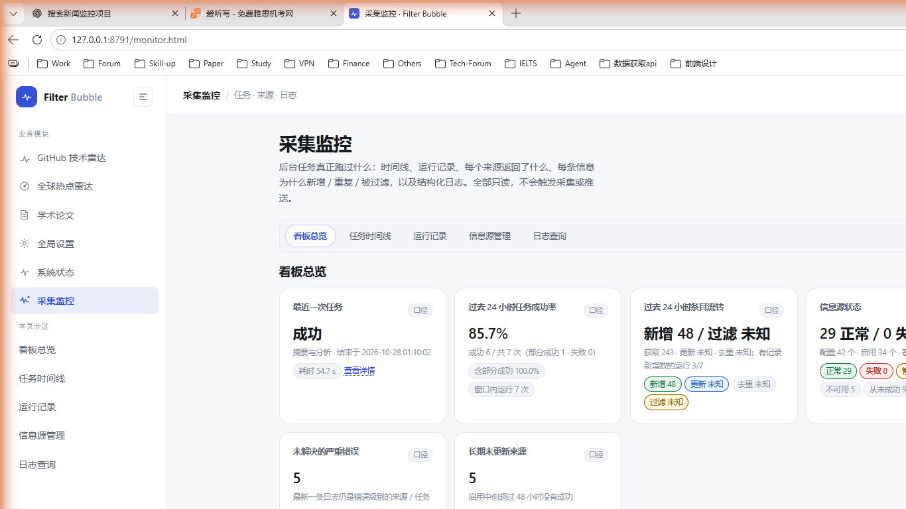
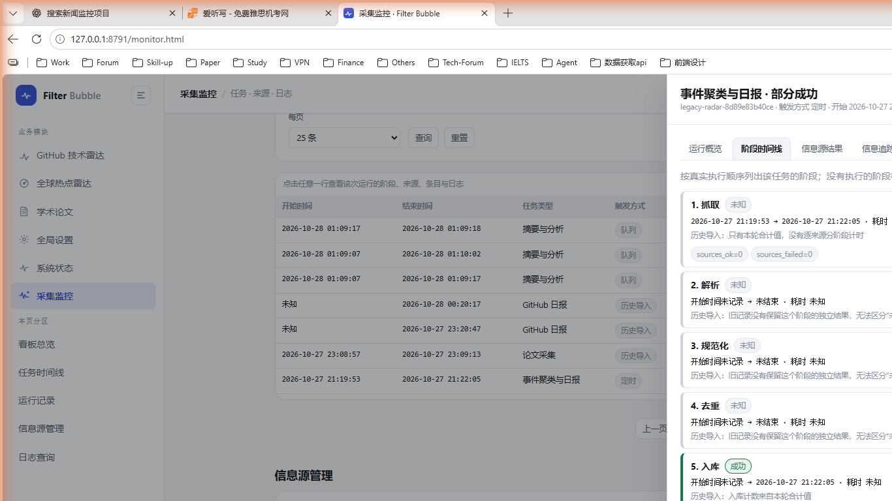
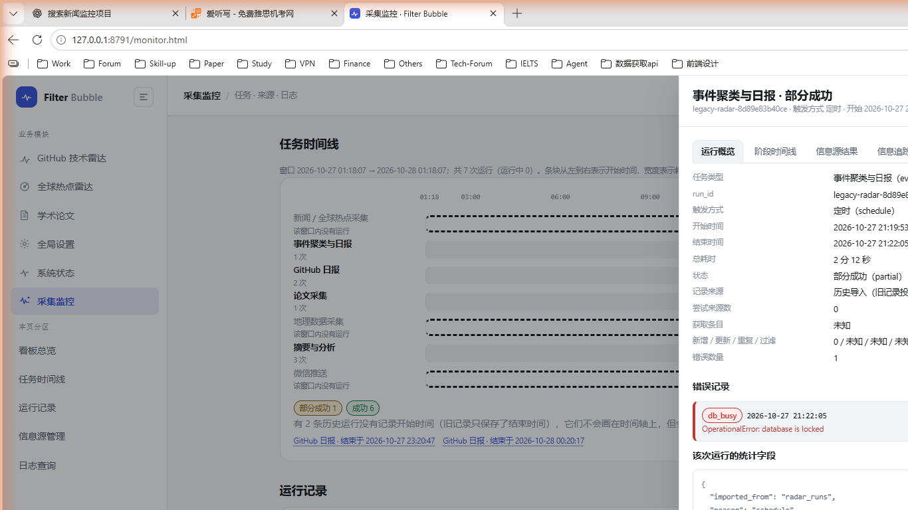
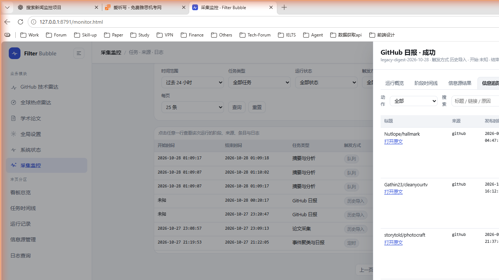
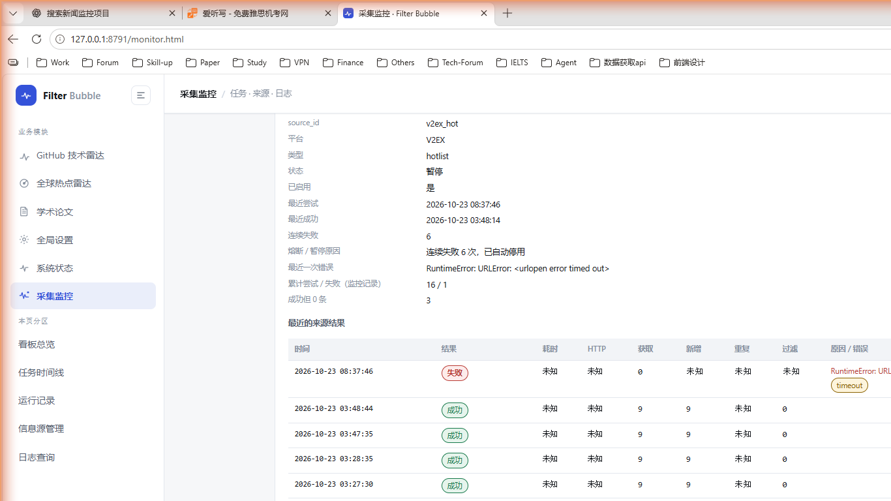
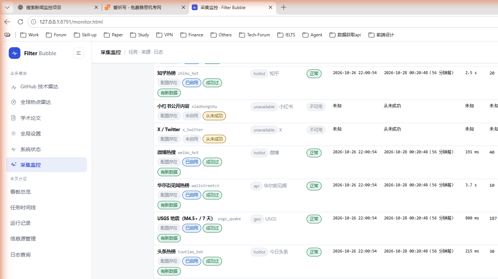
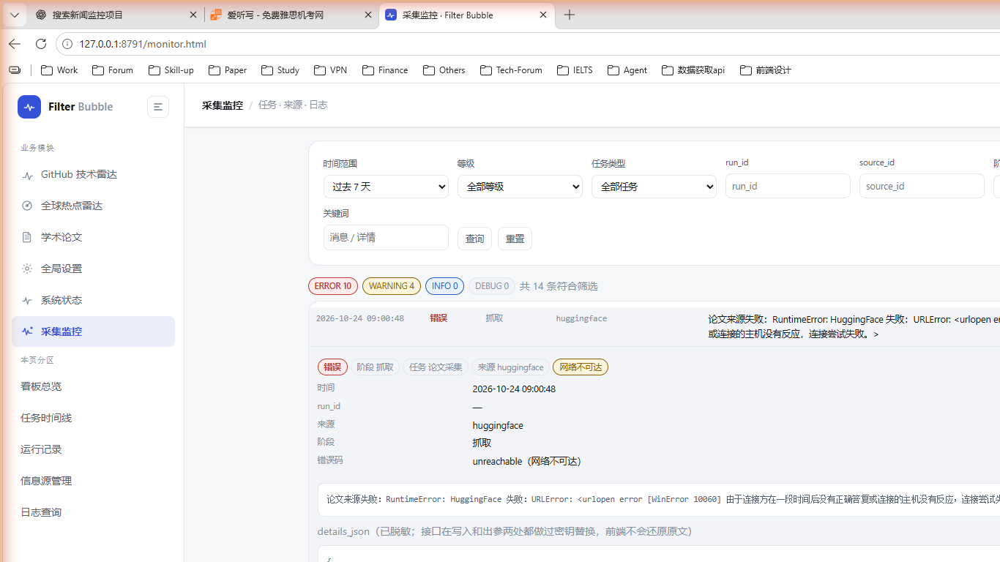

# 采集监控（只读运维后台）

左侧导航第六项，入口 <http://127.0.0.1:8791/monitor.html>。它回答的问题只有一个：
**后台任务到底跑过什么、每个来源返回了什么、每条信息为什么被新增 / 去重 / 过滤、出错时错误码是什么。**

与「系统状态」页（`/status.html`）的分工：

| 页面 | 负责 |
|---|---|
| `/status.html` | 各模块现在是否正常、下次何时跑（概览） |
| `/monitor.html` | 任务运行时间线与逐次详情、逐来源结果、逐条处理结果、结构化日志查询 |

监控页 **只读**：所有数据来自本机 `GET /api/monitor/*`，页面里没有任何写请求，
不会触发采集、聚类、推送或写库（`POST /api/monitor/*` 会直接返回 405）。



---

## 一、五个分区

| 分区 | 内容 |
|---|---|
| 看板总览 | 6 张统计卡 + 统计口径说明 + 「需要处理的问题」清单 |
| 任务时间线 | 过去 24 小时 / 7 天 / 30 天的真实运行，按 7 类任务分组，可点开详情 |
| 运行记录 | 可搜索 / 可筛选 / 可分页的运行表，点行打开右侧抽屉 |
| 信息源管理 | 全部已配置来源的状态、历史与熔断原因，支持搜索/分类/状态筛选和排序 |
| 日志查询 | 结构化日志的筛选、分页、详情展开与脱敏复制 |

### 任务类型（7 类）

`news_collect` 新闻 / 全球热点采集 ·
`event_report` 事件聚类与日报 ·
`github_daily` GitHub 日报 ·
`papers_collect` 论文采集 ·
`geo_collect` 地理数据采集 ·
`summary` 摘要与分析 ·
`wechat_push` 微信推送

时间线 **七行全保留**：某一类在这个窗口里没跑过，本身就是要看的覆盖缺口，行内会写「该窗口内没有运行」，
而不是把这一行藏掉。

### 阶段（真实执行顺序）

`fetch` 抓取 → `parse` 解析 → `normalize` 规范化 → `deduplicate` 去重 → `persist` 入库 →
`cluster` 聚类 → `score` 评分 → `geo_tag` 地理标注 → `report` 日报 → `summary` 摘要 → `push` 推送

每个任务类型有自己的阶段计划（见 `core/monitor/store.py` 的 `TASK_STAGES`）。
**没执行的阶段必须显示成「已跳过 / 不适用 / 未知」，不能显示成成功**：

- 实时埋点里没写过记录的阶段 → `skipped`（本次没执行；失败/被中断时还会写明「运行在更早阶段失败」）；
- 任务仍在运行 → `pending`；
- 历史导入的运行 → `unknown`，附「旧记录没有保留这个阶段的独立结果，无法区分“未执行”和“执行过但未记录”」。





---

## 二、统计口径（界面里可点「口径」按钮直接看）

页面上的每个数字都必须在界面上解释得清。原文如下（`store._CALIBER`）：

| 卡片 | 口径 |
|---|---|
| 最近一次任务结果与结束时间 | 取 `COALESCE(结束时间, 开始时间)` 最新的一条运行记录；没有任何记录时显示未知。 |
| 过去 24 小时成功率 | 分母是过去 24 小时内**已结束**（成功 / 部分成功 / 失败）的运行数，不含运行中、被中断与状态未知的运行；成功只统计「成功」，部分成功单列。分母为 0 时显示**未知**而不是 0%。 |
| 过去 24 小时新增 / 更新 / 去重 / 过滤 | 过去 24 小时内各次运行记录的条目计数求和。只累加**有记录**的运行，并给出「有记录运行数 / 运行总数」，缺记录的运行不按 0 计算。 |
| 信息源状态与数量 | 来源总数来自当前配置（含自定义 RSS 与 AnySearch 查询）；状态来自真实采集结果。「正常 / 失败 / 暂停」的失败与暂停以最近一次采集结果为准，「最近成功」是独立字段——一个来源可以现在失败但历史上成功过。返回 0 条算成功（列为「成功但 0 条」），不等于失败。 |
| 最近一次成功采集 | 最近一次状态为成功 / 部分成功的**采集类**运行（新闻采集 / 事件日报 / 论文采集 / 地理采集）距现在的时长；没有任何成功记录时显示未知。 |
| 未解决的严重错误与长期未更新来源 | 未解决的严重错误：按来源或任务分组后，最新一条日志仍是 `ERROR` 的分组。长期未更新来源：启用中但超过 48 小时没有成功、或从未成功过的来源。 |

**历史不全时显示「未知」，绝不用 0 填充**：接口对每个统计都额外返回 `unknown` / `unknown_reason`
或 `coverage`（覆盖度），前端据此显示未知，并给出为什么未知。例如
`更新 未知 · 去重 未知 · 过滤 未知；有记录新增数的运行 3/7` 表示过去 24 小时里只有 3 条运行真的记录了新增数。

---

## 三、运行记录与筛选

- 字段：开始时间、结束时间、任务类型、触发方式、总耗时、状态、尝试来源数、获取条目数、新增、更新、重复、过滤、错误数量。
- 筛选：时间范围（24h / 7d / 30d / 全部）、任务类型、运行状态、触发方式、关键词（匹配 run_id / 任务 / 触发 / 状态 / 统计 / 错误文本）。
- 排序：开始时间、耗时、错误数量（升 / 降序）；时间与耗时为空的行永远排在最后，不会把「未知」挤到前面。
- 分页：25 / 50 / 100 条一页，接口上限 200。
- 点任意一行（或时间线上的任意条块）→ 右侧抽屉，**不会**为每个任务生成 HTML 文件。

抽屉分五个页签：运行概览 / 阶段时间线 / 信息源结果 / 信息追踪 / 本次日志。
页签是标准 `role="tablist"` + `role="tabpanel"`，支持 ← → 切换、Enter/Space 打开、Esc 关闭，
关闭后焦点回到当初打开它的那一行。

---

## 四、信息追踪：这一条信息到底怎么了



每一行显示：原始标题、原始链接（只有 `http`/`https` 且带主机名才渲染成外链）、来源、
发布时间、**实际采集时间**、处理动作（新增入库 / 更新 / 重复（未新增）/ 被过滤 / 已入库 / 未知）、
被过滤或去重的原因、`item_id` / `event_id` / `story_id`、以及**当前是否仍能在全球热点雷达里找到**。

- 没入库的条目也一样要能看到：`filtered` / `duplicate` 行保留 `reason`，不会因为「没进库」就消失。
- 标题或链接缺失时显示「（标题缺失）」「（没有链接）」；单条坏数据（`null`、非对象）只跳过这一行，
  不会让整张表报错。
- 论文条目的「仍在雷达」显示「不适用（论文）」，而不是伪装成「不在雷达库」。



在抽屉的「信息源结果」里点某个来源，或在「信息源管理」里点某一行，会展开**来源详情**：
source_id / 平台 / 类型 / 状态 / 是否启用 / 最近尝试 / 最近成功 / 连续失败 / 熔断原因 / 最近一次错误 /
累计尝试与失败 / 成功但 0 条次数，以及该来源**最近的来源结果**（时间、结果、耗时、HTTP、获取、新增、重复、过滤、原因·错误）
和**最近的来源日志**。

---

## 五、信息源管理：四个概念是分开的



界面上明确区分四个独立概念，并给出汇总：

| 概念 | 含义 |
|---|---|
| 配置存在 | 配置里有这一条（含自定义 RSS / AnySearch 查询） |
| 当前启用 | `enabled` 为真；配置里写了不代表启用 |
| 最近成功 | 历史上成功过；启用不代表最近成功过 |
| 具有新数据 | 本轮真的带回了新增条目；成功也不代表这次有新增 |

字段：来源名称与类型、当前状态、最近尝试时间、最近成功时间、最近一次耗时、最近一次获取条目数、
最近一次新增数、连续失败次数、熔断 / 暂停原因、最近一次错误。
排序：连续失败、长期没有成功、最近耗时、最近获取条目数、名称。

排序键走接口白名单：传了不支持的键会明确退回默认排序（`failures`），并在响应的 `sort` 里说明，
不会悄悄换一种顺序。

---

## 六、日志查询与脱敏



- 过滤：时间范围、DEBUG / INFO / WARNING / ERROR、任务类型、`run_id`、`source_id`、阶段、错误码、关键词。
- 每条显示：时间、等级、阶段、任务或来源、消息。
- 点开一行展开 `details_json`（错误类型、HTTP 状态、解析上下文、相关记录 ID），并有「复制脱敏详情」按钮。
- **永远不会一次性返回全量日志**：默认每页 50 条（上限 200），「加载更早」把更旧的一页**追加**在列表下方，
  当前阅读位置不动；自动刷新只按 `since_id` 增量拉比当前最新 id 更新的日志，列表底部插入，
  只有用户本来就在顶部附近时才跟随滚动——历史日志不会因为自动刷新跳回顶部。
- 自动刷新默认**关闭**（点击才读）；开启后默认 15 秒，可选 10 / 15 / 30 / 60 秒，
  页面不可见（`document.hidden`）时暂停，回到前台补一次。
- 脱敏：写入与出参两处都会对 `message` / `details_json` / 错误文本做密钥替换，前端只展示接口返回的脱敏结果，
  不做任何「还原原文」的操作。

---

## 七、接口

全部是 `GET`，全部只读；`POST` 一律 405。所有列表都分页并有上限，异常会返回可诊断 JSON
（`{error, error_type, path, hint}`），不会把栈抛给调用方。

| 路径 | 参数 | 说明 |
|---|---|---|
| `/api/monitor/health` | — | 探活 + 各表计数 |
| `/api/monitor/meta` | — | 任务类型、状态、等级、阶段、错误码、窗口、保留天数、口径 |
| `/api/monitor/overview` | `hours`, `stale_hours` | 看板统计 + 口径 + 未解决错误 + 长期未更新来源 |
| `/api/monitor/timeline` | `window`, `from`, `to`, `task` | 按任务类型分组的运行（含运行中数量、无开始时间的条数） |
| `/api/monitor/runs` | `window`, `from`, `to`, `task`, `status`, `trigger`, `q`, `sort`, `order`, `page`, `page_size` | 运行记录列表 |
| `/api/monitor/run` | `id`, `items_page`, `items_size`, `items_action`, `items_q`, `items_source`, `logs_*` | 单次运行详情：运行 + 阶段 + 来源 + 条目 + 日志 + 口径 |
| `/api/monitor/run/items` | `id`, `page`, `page_size`, `action`, `q`, `source_id` | 单独翻某次运行的逐条处理结果 |
| `/api/monitor/run/logs` | `id`, `page`, `page_size`, `level`, `stage`, `source_id` | 单独翻某次运行的日志 |
| `/api/monitor/sources` | `q`, `kind`, `status`, `enabled`, `sort`, `order`, `stale_hours` | 来源视图 + 四个概念汇总 |
| `/api/monitor/source` | `id`, `limit` | 单来源：配置/状态 + 最近结果 + 候选条目 + 日志 |
| `/api/monitor/logs` | `window`, `from`, `to`, `level`, `task`, `run_id`, `source_id`, `stage`, `error_code`, `q`, `page`, `page_size`, `since_id`, `before_id` | 结构化日志（等级计数与列表同窗口） |
| `/api/monitor/log` | `id` | 单条日志（含脱敏后的 `details_json`） |

样例（本机实测，字段已截断）：

```json
GET /api/monitor/overview
{
  "generated_at": "2026-10-28T01:25:17+08:00",
  "window": {"hours": 24, "from": "2026-10-27T01:25:17+08:00"},
  "last_run": {"run_id": "summary-010907-5960d8", "task": "summary", "task_label": "摘要与分析",
               "status": "ok", "finished_at": "2026-10-28T01:10:02+08:00", "duration_ms": 54707},
  "success_rate": {"value": 0.8571, "value_including_partial": 1.0, "ok": 6, "partial": 1,
                   "failed": 0, "total": 7, "runs_in_window": 7, "unknown": false},
  "item_flow": {"fetched": 243, "new": 48, "updated": null, "duplicate": null, "filtered": null,
                "coverage": {"items_new": 3, "items_duplicate": 0, "items_filtered": 0},
                "runs_in_window": 7, "unknown": false},
  "sources": {"configured": 42, "enabled": 34, "ok": 29, "error": 0, "paused": 4, "unavailable": 5,
              "never_succeeded": 9, "with_new_data": 27},
  "last_success": {"task": "papers_collect", "at": "2026-10-27T23:09:13+08:00", "age_minutes": 136.1},
  "open_errors": {"count": 5, "items": [{"source_id": "huggingface", "error_code": "unreachable"}]},
  "stale_sources": {"count": 5, "threshold_hours": 48,
                    "items": [{"source_id": "query"}, {"source_id": "v2ex_hot"}]}
}
```

```json
GET /api/monitor/run?id=legacy-radar-a7fb050c53b4
{
  "run": {"run_id": "legacy-radar-a7fb050c53b4", "task": "event_report", "status": "ok",
          "origin": "legacy", "trigger": "schedule"},
  "stages": [{"name": "fetch", "status": "ok", "seq": 1},
             {"name": "parse", "status": "unknown", "composed": true,
              "result": {"note": "历史导入：旧记录没有保留这个阶段的独立结果，无法区分“未执行”和“执行过但未记录”"}},
             {"name": "push", "status": "skipped"}],
  "sources": [{"source_id": "cn_scroll", "status": "ok", "fetched": 30, "items_new": 7},
              {"source_id": "gdelt", "status": "failed", "error": "RuntimeError: HTTP 429",
               "error_code": "http_429"}],
  "items": {"total": 375, "page": 1, "page_size": 50,
            "summary": {"total": 375, "by_action": {"unknown": 375}},
            "items": [{"title": "…", "link": "https://…", "source_id": "cn_scroll",
                       "published_at": "2026-10-26T21:21:00+08:00",
                       "collected_at": "2026-10-26T22:00:10+08:00", "action": "unknown",
                       "reason": "历史导入：不在雷达库里的条目没有被记录过处理结果",
                       "item_id": "17376", "event_id": "ev-19261d642ec8ab",
                       "story_id": "st-db50b65687d6b5", "in_radar": true}]},
  "logs": {"total": 0, "logs": []}
}
```

---

## 八、数据是怎么来的

两条来源，都是真实的，没有模拟：

1. **实时埋点**（`core/monitor/instrument.py`）
   `with monitor.run("event_report", trigger="schedule") as mon:` 包住业务流水线；
   `mon.phase("fetch")` 记阶段，逐来源写 `monitor_source_results`，逐条写 `monitor_item_actions`，
   `monitor.log_event(...)` 写结构化日志。所有监控写入都包在 `_safe` 里：
   **监控失败只打一行 stderr，绝不改变业务行为**，用的是独立连接、不参与业务事务。
   单次运行最多逐条记录 2000 条（`MAX_ITEMS_PER_RUN`），超出部分在 stats 里说明。

2. **历史导入**（`store.import_legacy`，幂等，带 `origin='legacy'` 与 `legacy_ref` 判重）
   把已经存在的真实记录投影进监控表：`radar_runs` → `event_report` 运行（一条旧运行 = 一条真实运行）、
   `paper_source_runs`（按 `started_at` 收成一组 = 一次论文采集）、`digests` → `github_daily`、
   `push_log` / `radar_push_log` → `wechat_push`，以及旧表里已有的错误文本 → ERROR 日志。
   已经导入过的行用 `legacy_ref` 判重，重复启动不会重复导入；单个导入器失败不影响其他，也不会记「已完成」。

监控表（`monitor_runs` / `monitor_stages` / `monitor_source_results` / `monitor_item_actions` / `monitor_logs`）
独立于业务表，**默认保留 45 天**（`_RETENTION_DAYS`），启动时按需清理。

---

## 九、本机实测数据快照（2026-10-28 01:25 +08:00，真实库）

```
GET /api/monitor/health → runs 46, runs_running 0, stages 154, source_results 435,
                          items 2387, logs 14, legacy_runs 43
```

| 指标 | 实测值 |
|---|---|
| 运行总数 / 其中历史导入 | 46 / 43 |
| 7 天运行分布 | event_report 23、github_daily 7、papers_collect 7、wechat_push 6、summary 3、news_collect 0、geo_collect 0 |
| 7 天状态分布 | 成功 40、部分成功 4、失败 2，无开始时间（原型只存了结束时间）7 条 |
| 24 小时成功率 | 85.7%（成功 6 / 共 7 次，部分成功 1） |
| 24 小时条目流转 | 获取 243、新增 48；更新 / 去重 / 过滤未知（只有 3 条运行记录了新增数） |
| 来源 | 配置 42、启用 34、正常 29、失败 0、暂停 4、不可用 5、从未成功 9、长期未更新 13 |
| 来源结果行 | 成功 361、成功但 0 条 48、失败 26（含 `http_429`、`timeout`） |
| 逐条处理结果 | 新闻 1389 条（历史导入，动作未知）、论文 800 条（已入库）、GitHub 198 条（已入库） |
| 未解决的严重错误 | 5（huggingface `unreachable`；event_report `db_busy` ×2、`internal` ×2） |
| 日志 | 14 条（ERROR 10 / WARNING 4），错误码 timeout 4、unreachable 2、internal 2、db_busy 2 |

**当前数据缺口（页面会照实显示未知，不会补成成功）**：新闻采集与地理采集在监控上线后还没跑过，
所以 `news_collect` / `geo_collect` 这两条时间线是「该窗口内没有运行」，
历史新闻条目只有合计值、逐条动作是 `unknown`；
逐来源的 HTTP 状态与耗时对历史导入行是 `null`（旧库没存），页面显示未知。

---

## 十、手工验收步骤（真实浏览器，本机实测通过）

1. 启动：`python app.py serve`（Windows 双击 `start.bat`），打开 <http://127.0.0.1:8791/monitor.html>。
2. **看板**：核对 6 张卡片的数字与 `/api/monitor/overview` 返回一致；点任意「口径」按钮能看到解释；
   把某段时间记录清空（或换一个没有运行的库）后，成功率/条目流转应显示「未知」而不是 0%。
3. **时间线**：范围切 24h / 7d / 30d；确认刻度落在整点、七类任务各一行、空行写「该窗口内没有运行」；
   点一个条块打开抽屉。
4. **运行记录**：改时间范围/任务/状态/关键词/排序 → 查询；翻页；点一行打开抽屉；
   按 Esc 关闭，焦点应回到那一行。
5. **抽屉**：切到「阶段时间线」——没执行的阶段必须是「已跳过 / 未知」，不能是成功；
   切到「信息追踪」——看到标题、来源、发布时间、采集时间、动作、原因、item_id / event_id / story_id、仍在雷达；
   在「信息源结果」里点一个来源，展开它的候选条目与来源日志。
6. **信息源管理**：搜索、类型/状态筛选、按连续失败/长期没有成功/最近耗时排序；
   确认返回 0 条显示「成功但 0 条」而不是失败。
7. **日志**：勾选「自动刷新」（默认 15 秒）看增量追加不跳回顶部；把窗口滚到中间，等一次刷新，阅读位置应保持；
   点一行展开 `details_json`，确认按钮是「复制脱敏详情」；筛选等级/阶段/错误码/关键词；
   点「加载更早」确认是**追加**而不是替换整页。
8. **窗口不可见时暂停**：切到别的标签页几十秒再回来，顶栏应显示「页面不可见，已暂停高频刷新」，回来后自动补一次。
9. **响应式**：把窗口拖到 430px 宽，侧栏变抽屉、卡片单列、表格横向滚动。


---

## 十一、测试与验收报告

```bash
# 全部测试（本机 runtime python，隔离数据库、不联网、不写真实用户数据）
runtime\python\python.exe -m unittest tests.test_monitor_api tests.test_web ...
# 或只跑监控相关
runtime\python\python.exe -m unittest tests.test_monitor_api
```

| 套件 | 用例数 | 结果 |
|---|---|---|
| `tests/test_monitor_api.py` | 62 | 通过 |
| 全量（14 个测试模块） | 530 | 通过 |

`tests/test_monitor_api.py` 覆盖任务书要求的 11 项：

1. 页面主入口与导航链接（每个页面都有 `/monitor.html`，`/status.html` 仍保留）；
2. 运行记录的时间范围 / 任务 / 状态 / 关键词筛选、分页、排序与详情查询；
3. 来源历史查询与状态显示、四个概念互相独立、0 条不等于失败；
4. 信息处理结果与过滤原因展示（含坏数据行不炸表）；
5. 日志筛选、分页与增量、详情展开、敏感信息脱敏；
6. 接口失败（500 + 可诊断 JSON）与空数据状态（未知而不是 0）；
7. 自动刷新与页面不可见时暂停、日志增量不跳回顶部；
8. 错误内容里的 HTML / JavaScript 不会执行（脚本无 `innerHTML`/`outerHTML`/`insertAdjacentHTML`/`document.write`/`eval`/`new Function`）；
9. 页面不依赖外部 CDN（页面里没有 http(s) 资源引用，监控 API 调用全部指向 `/api/monitor`）；
10. `web/*.css` 仍然只有 `styles.css`；
11. 原有的全球态势、GitHub、论文、收藏夹、系统状态功能照旧（各自套件全绿）。

**浏览器实测**：本机用真实 Edge 打开页面逐项走完第十节的步骤（不是静态检查）：
看板数字与接口一致、时间线整点刻度、抽屉五个页签、阶段时间线、信息追踪分页、
来源详情候选条目与日志、日志详情展开与脱敏提示、移动端单列。
过程中修掉了三个只有真跑页面才会暴露的问题：时间线刻度的 `longWindow` 作用域错误（整页报「读取失败」）、
阶段序号混用旧记录 `seq` 导致看起来乱序、以及 `window=all` 时日志等级计数变成空字典会显示假的「ERROR 0」。

> 仓库里没有 Playwright / Puppeteer 这类浏览器自动化依赖，也没有为了测试引入新依赖。
> 页面级回归靠 `TestMonitorPageContract`（22 条 DOM / 安全 / 空状态 / 轮询契约）+ 上面的真实浏览器手工验收。

---

## 十二、已知边界

- 监控是**旁路**：埋点写不进去时只丢监控数据，采集照常；因此极端情况下某个阶段可能没有记录，
  页面会显示未知而不是补一个猜测值。
- 历史导入的行没有逐来源分阶段计时，`stages` 里很多阶段是 `unknown`，来源行的耗时/HTTP 也是未知。
- 逐条处理结果受 `MAX_ITEMS_PER_RUN`（2000）限制，超出部分只在 stats 里给出总数。
- `monitor_*` 默认保留 45 天，过期运行会从列表消失（页面会提示「记录可能已被清理」）。
- 页面不抓取任何第三方来源，也不展示服务端密钥；外链只允许 `http`/`https` 并带 `target=_blank rel="noopener noreferrer"`。